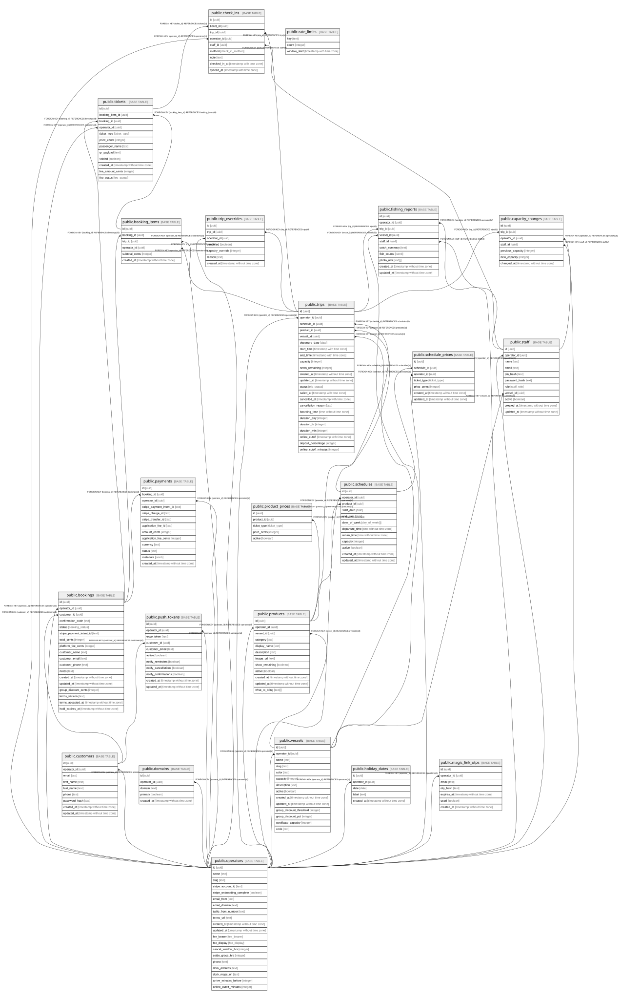

# Open Boat

## Tables

| Name                                                  | Columns | Comment                                                                                                                                                                                                   | Type       |
| ----------------------------------------------------- | ------- | --------------------------------------------------------------------------------------------------------------------------------------------------------------------------------------------------------- | ---------- |
| [public.booking_items](public.booking_items.md)       | 6       | One row per trip within a booking (multi-trip cart). Tickets hang off it.                                                                                                                                 | BASE TABLE |
| [public.bookings](public.bookings.md)                 | 18      | One customer purchase. Can span several trips through booking_items.                                                                                                                                      | BASE TABLE |
| [public.check_ins](public.check_ins.md)               | 9       | One boarding check-in per ticket. Can be recorded offline in the mate app and synced later.                                                                                                               | BASE TABLE |
| [public.customers](public.customers.md)               | 9       | Consumer accounts, signed in by email one-time code. Separate from staff: incompatible auth and different data.                                                                                           | BASE TABLE |
| [public.domains](public.domains.md)                   | 5       | Hostname to operator mapping used by the Edge middleware in platform mode. An operator may have several domains.                                                                                          | BASE TABLE |
| [public.operators](public.operators.md)               | 20      | One row per fishing boat business (tenant root). A single-deploy install has exactly one row; the centralized platform has one per operator, resolved from the request hostname via domains.              | BASE TABLE |
| [public.payments](public.payments.md)                 | 13      | Stripe payment record, written when payment_intent.succeeded arrives.                                                                                                                                     | BASE TABLE |
| [public.product_prices](public.product_prices.md)     | 5       | Default price per ticket type for a product. Adult, child and senior each get a row.                                                                                                                      | BASE TABLE |
| [public.products](public.products.md)                 | 12      | Trip type sold on a vessel, e.g. Sea Bass Fishing Express.                                                                                                                                                | BASE TABLE |
| [public.schedules](public.schedules.md)               | 12      | Recurring departure pattern for a product. Trips are materialized from it when it is saved.                                                                                                               | BASE TABLE |
| [public.staff](public.staff.md)                       | 11      | Admin and mate accounts. Mates sign in to the tablet app with a PIN; admins sign in to the web dashboard with a password.                                                                                 | BASE TABLE |
| [public.tickets](public.tickets.md)                   | 12      | One per passenger, on one trip via its booking_item.                                                                                                                                                      | BASE TABLE |
| [public.trip_overrides](public.trip_overrides.md)     | 7       | Admin-applied exceptions for a specific trip: cancellations or capacity changes.                                                                                                                          | BASE TABLE |
| [public.trips](public.trips.md)                       | 23      | One materialized departure. Written when a schedule is saved, or added by hand as a one-off. (schedule_id, departure_date) is unique.                                                                     | BASE TABLE |
| [public.vessels](public.vessels.md)                   | 14      | Boats owned by an operator.                                                                                                                                                                               | BASE TABLE |
| [public.holiday_dates](public.holiday_dates.md)       | 5       | Dates meant to be priced as weekend/holiday regardless of day of week (e.g. Labor Day, July 4th). Not yet read by booking or pricing.                                                                     | BASE TABLE |
| [public.schedule_prices](public.schedule_prices.md)   | 7       | Per-schedule price overrides. Take precedence over product_prices at booking time, which enables weekday vs. weekend pricing through separate schedules. Falls back to product_prices when no row exists. | BASE TABLE |
| [public.magic_link_otps](public.magic_link_otps.md)   | 7       | 6-digit one-time sign-in codes for customers. Expire after 15 minutes.                                                                                                                                    | BASE TABLE |
| [public.push_tokens](public.push_tokens.md)           | 11      | Expo push tokens for customer devices, used for confirmation, reminder and cancellation pushes.                                                                                                           | BASE TABLE |
| [public.capacity_changes](public.capacity_changes.md) | 7       | Audit log of capacity adjustments made by staff on a trip.                                                                                                                                                | BASE TABLE |
| [public.fishing_reports](public.fishing_reports.md)   | 10      | Captain's report after a trip. One per trip.                                                                                                                                                              | BASE TABLE |
| [public.rate_limits](public.rate_limits.md)           | 3       | Fixed-window rate-limit buckets for auth and booking endpoints. Rows older than a day are deleted by the expire-pending-bookings cron.                                                                    | BASE TABLE |

## Enums

| Name                   | Values                                           |
| ---------------------- | ------------------------------------------------ |
| public.booking_status  | cancelled, confirmed, pending                    |
| public.check_in_method | manual, name_search, qr                          |
| public.day_of_week     | fri, mon, sat, sun, thu, tue, wed                |
| public.fee_bearer      | operator, passenger                              |
| public.fee_display     | folded, itemized                                 |
| public.fee_status      | earned, held, reversed                           |
| public.staff_role      | admin, mate                                      |
| public.ticket_type     | adult, child, senior                             |
| public.trip_status     | cancelled, pending_settlement, sailed, scheduled |

## Relations

---

> Generated by [tbls](https://github.com/k1LoW/tbls)
