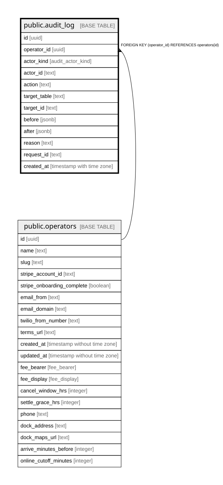

# public.audit_log

## Description

Who changed money, seats or settings (row 12, AR-9). Written by each command in the transaction that makes the change. Read-only once written.

## Columns

| Name         | Type                     | Default           | Nullable | Children | Parents                                 | Comment                                                                                                                  |
| ------------ | ------------------------ | ----------------- | -------- | -------- | --------------------------------------- | ------------------------------------------------------------------------------------------------------------------------ |
| id           | uuid                     | gen_random_uuid() | false    |          |                                         |                                                                                                                          |
| operator_id  | uuid                     |                   | true     |          | [public.operators](public.operators.md) | The operator the change belongs to; null for platform-wide changes such as adding a platform user.                       |
| actor_kind   | audit_actor_kind         |                   | false    |          |                                         |                                                                                                                          |
| actor_id     | text                     |                   | true     |          |                                         | staff.id (staff), platform_users.id (platform), customers.id (customer), the job name (system) or the evt_… id (stripe). |
| action       | text                     |                   | false    |          |                                         | What was done, as noun.verb: ticket.refund, trip.cancel, trip.set_capacity, operator.update, staff.update, …             |
| target_table | text                     |                   | false    |          |                                         |                                                                                                                          |
| target_id    | text                     |                   | true     |          |                                         | Text, with no foreign key, so the row outlives what it describes (a deleted booking, a demo reset).                      |
| before       | jsonb                    |                   | true     |          |                                         | The changed fields before the change; secrets (password and PIN hashes) are recorded only as changed.                    |
| after        | jsonb                    |                   | true     |          |                                         |                                                                                                                          |
| reason       | text                     |                   | true     |          |                                         |                                                                                                                          |
| request_id   | text                     |                   | true     |          |                                         | The request that made the change (Vercel's x-vercel-id), to find it in the logs.                                         |
| created_at   | timestamp with time zone | now()             | false    |          |                                         |                                                                                                                          |

## Constraints

| Name                                  | Type        | Definition                                         |
| ------------------------------------- | ----------- | -------------------------------------------------- |
| audit_log_operator_id_operators_id_fk | FOREIGN KEY | FOREIGN KEY (operator_id) REFERENCES operators(id) |
| audit_log_pkey                        | PRIMARY KEY | PRIMARY KEY (id)                                   |

## Indexes

| Name                           | Definition                                                                                            |
| ------------------------------ | ----------------------------------------------------------------------------------------------------- |
| audit_log_pkey                 | CREATE UNIQUE INDEX audit_log_pkey ON public.audit_log USING btree (id)                               |
| audit_log_operator_created_idx | CREATE INDEX audit_log_operator_created_idx ON public.audit_log USING btree (operator_id, created_at) |
| audit_log_target_idx           | CREATE INDEX audit_log_target_idx ON public.audit_log USING btree (target_table, target_id)           |
| audit_log_actor_idx            | CREATE INDEX audit_log_actor_idx ON public.audit_log USING btree (actor_kind, actor_id, created_at)   |

## Relations

---

> Generated by [tbls](https://github.com/k1LoW/tbls)
