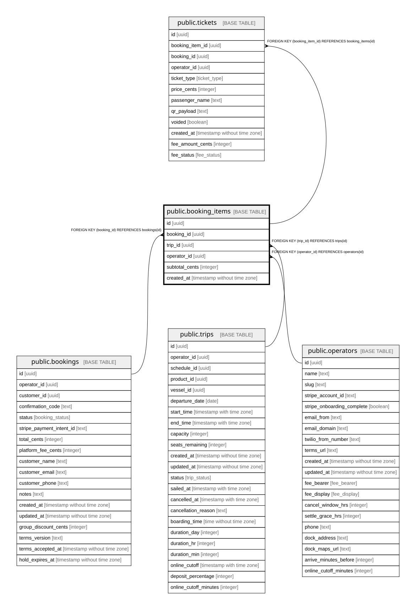

# public.booking_items

## Description

One row per trip within a booking (multi-trip cart). Tickets hang off it.

## Columns

| Name           | Type                        | Default           | Nullable | Children                            | Parents                                 | Comment                                                       |
| -------------- | --------------------------- | ----------------- | -------- | ----------------------------------- | --------------------------------------- | ------------------------------------------------------------- |
| id             | uuid                        | gen_random_uuid() | false    | [public.tickets](public.tickets.md) |                                         |                                                               |
| booking_id     | uuid                        |                   | false    |                                     | [public.bookings](public.bookings.md)   |                                                               |
| trip_id        | uuid                        |                   | false    |                                     | [public.trips](public.trips.md)         |                                                               |
| operator_id    | uuid                        |                   | false    |                                     | [public.operators](public.operators.md) | Owning operator. Every query on this table must filter by it. |
| subtotal_cents | integer                     |                   | false    |                                     |                                         | Ticket total for this trip, in cents.                         |
| created_at     | timestamp without time zone | now()             | false    |                                     |                                         |                                                               |

## Constraints

| Name                                      | Type        | Definition                                         |
| ----------------------------------------- | ----------- | -------------------------------------------------- |
| booking_items_pkey                        | PRIMARY KEY | PRIMARY KEY (id)                                   |
| booking_items_booking_id_bookings_id_fk   | FOREIGN KEY | FOREIGN KEY (booking_id) REFERENCES bookings(id)   |
| booking_items_operator_id_operators_id_fk | FOREIGN KEY | FOREIGN KEY (operator_id) REFERENCES operators(id) |
| booking_items_trip_id_trips_id_fk         | FOREIGN KEY | FOREIGN KEY (trip_id) REFERENCES trips(id)         |

## Indexes

| Name                      | Definition                                                                              |
| ------------------------- | --------------------------------------------------------------------------------------- |
| booking_items_pkey        | CREATE UNIQUE INDEX booking_items_pkey ON public.booking_items USING btree (id)         |
| booking_items_booking_idx | CREATE INDEX booking_items_booking_idx ON public.booking_items USING btree (booking_id) |

## Relations

---

> Generated by [tbls](https://github.com/k1LoW/tbls)
