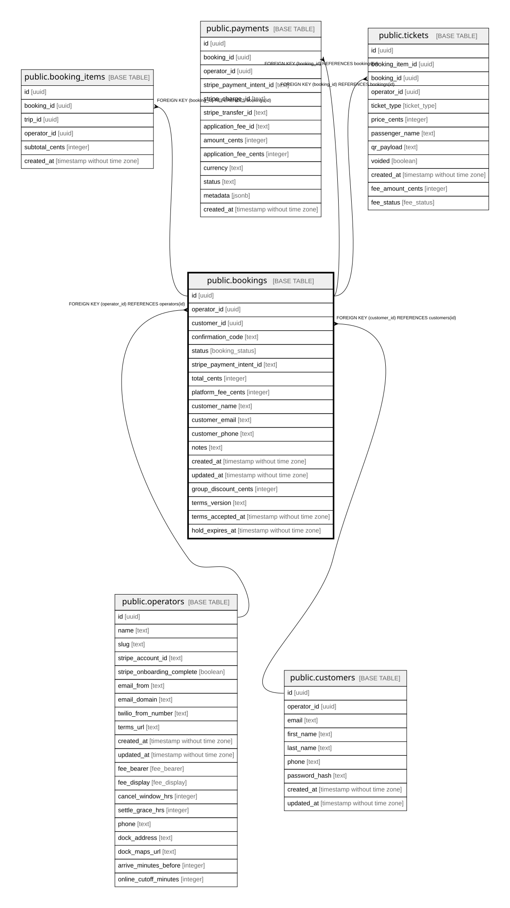

# public.bookings

## Description

One customer purchase. Can span several trips through booking_items.

## Columns

| Name                     | Type                        | Default                   | Nullable | Children                                                                                                                  | Parents                                 | Comment                                                                                                                                   |
| ------------------------ | --------------------------- | ------------------------- | -------- | ------------------------------------------------------------------------------------------------------------------------- | --------------------------------------- | ----------------------------------------------------------------------------------------------------------------------------------------- |
| id                       | uuid                        | gen_random_uuid()         | false    | [public.booking_items](public.booking_items.md) [public.payments](public.payments.md) [public.tickets](public.tickets.md) |                                         |                                                                                                                                           |
| operator_id              | uuid                        |                           | false    |                                                                                                                           | [public.operators](public.operators.md) | Owning operator. Every query on this table must filter by it.                                                                             |
| customer_id              | uuid                        |                           | true     |                                                                                                                           | [public.customers](public.customers.md) | Null = guest checkout.                                                                                                                    |
| confirmation_code        | text                        |                           | false    |                                                                                                                           |                                         | 6-character code shown to the customer.                                                                                                   |
| status                   | booking_status              | 'pending'::booking_status | false    |                                                                                                                           |                                         | pending (seats held, payment not confirmed) -\> confirmed (payment_intent.succeeded) or cancelled (refunded, expired or admin-cancelled). |
| stripe_payment_intent_id | text                        |                           | true     |                                                                                                                           |                                         | Stripe PaymentIntent for this booking.                                                                                                    |
| total_cents              | integer                     |                           | false    |                                                                                                                           |                                         | Amount charged, in cents.                                                                                                                 |
| platform_fee_cents       | integer                     |                           | false    |                                                                                                                           |                                         | Platform fee for the booking: $1.50 x ticket count.                                                                                       |
| customer_name            | text                        |                           | true     |                                                                                                                           |                                         |                                                                                                                                           |
| customer_email           | text                        |                           | false    |                                                                                                                           |                                         | Contact email captured at checkout. Required even for guests.                                                                             |
| customer_phone           | text                        |                           | true     |                                                                                                                           |                                         |                                                                                                                                           |
| notes                    | text                        |                           | true     |                                                                                                                           |                                         |                                                                                                                                           |
| created_at               | timestamp without time zone | now()                     | false    |                                                                                                                           |                                         |                                                                                                                                           |
| updated_at               | timestamp without time zone | now()                     | false    |                                                                                                                           |                                         |                                                                                                                                           |
| group_discount_cents     | integer                     | 0                         | false    |                                                                                                                           |                                         | Total group discount applied.                                                                                                             |
| terms_version            | text                        |                           | true     |                                                                                                                           |                                         | Version of the terms the customer accepted.                                                                                               |
| terms_accepted_at        | timestamp without time zone |                           | true     |                                                                                                                           |                                         | When the customer accepted the terms.                                                                                                     |
| hold_expires_at          | timestamp without time zone |                           | true     |                                                                                                                           |                                         | When the seat hold on a pending booking lapses. The expiry cron releases the seats after this.                                            |

## Constraints

| Name                                     | Type        | Definition                                         |
| ---------------------------------------- | ----------- | -------------------------------------------------- |
| bookings_pkey                            | PRIMARY KEY | PRIMARY KEY (id)                                   |
| bookings_confirmation_code_unique        | UNIQUE      | UNIQUE (confirmation_code)                         |
| bookings_stripe_payment_intent_id_unique | UNIQUE      | UNIQUE (stripe_payment_intent_id)                  |
| bookings_customer_id_customers_id_fk     | FOREIGN KEY | FOREIGN KEY (customer_id) REFERENCES customers(id) |
| bookings_operator_id_operators_id_fk     | FOREIGN KEY | FOREIGN KEY (operator_id) REFERENCES operators(id) |

## Indexes

| Name                                     | Definition                                                                                                             |
| ---------------------------------------- | ---------------------------------------------------------------------------------------------------------------------- |
| bookings_pkey                            | CREATE UNIQUE INDEX bookings_pkey ON public.bookings USING btree (id)                                                  |
| bookings_confirmation_code_unique        | CREATE UNIQUE INDEX bookings_confirmation_code_unique ON public.bookings USING btree (confirmation_code)               |
| bookings_stripe_payment_intent_id_unique | CREATE UNIQUE INDEX bookings_stripe_payment_intent_id_unique ON public.bookings USING btree (stripe_payment_intent_id) |
| bookings_operator_status_idx             | CREATE INDEX bookings_operator_status_idx ON public.bookings USING btree (operator_id, status)                         |
| bookings_payment_intent_idx              | CREATE INDEX bookings_payment_intent_idx ON public.bookings USING btree (stripe_payment_intent_id)                     |

## Relations

---

> Generated by [tbls](https://github.com/k1LoW/tbls)
