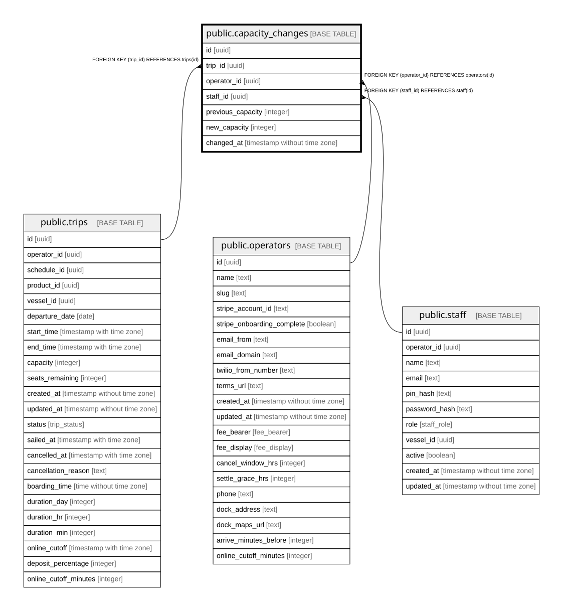

# public.capacity_changes

## Description

Audit log of capacity adjustments made by staff on a trip.

## Columns

| Name              | Type                        | Default           | Nullable | Children | Parents                                 | Comment                                                       |
| ----------------- | --------------------------- | ----------------- | -------- | -------- | --------------------------------------- | ------------------------------------------------------------- |
| id                | uuid                        | gen_random_uuid() | false    |          |                                         |                                                               |
| trip_id           | uuid                        |                   | false    |          | [public.trips](public.trips.md)         |                                                               |
| operator_id       | uuid                        |                   | false    |          | [public.operators](public.operators.md) | Owning operator. Every query on this table must filter by it. |
| staff_id          | uuid                        |                   | true     |          | [public.staff](public.staff.md)         | Staff member who made the change.                             |
| previous_capacity | integer                     |                   | false    |          |                                         |                                                               |
| new_capacity      | integer                     |                   | false    |          |                                         |                                                               |
| changed_at        | timestamp without time zone | now()             | false    |          |                                         |                                                               |

## Constraints

| Name                              | Type        | Definition                                         |
| --------------------------------- | ----------- | -------------------------------------------------- |
| capacity_changes_operator_id_fkey | FOREIGN KEY | FOREIGN KEY (operator_id) REFERENCES operators(id) |
| capacity_changes_staff_id_fkey    | FOREIGN KEY | FOREIGN KEY (staff_id) REFERENCES staff(id)        |
| capacity_changes_trip_id_fkey     | FOREIGN KEY | FOREIGN KEY (trip_id) REFERENCES trips(id)         |
| capacity_changes_pkey             | PRIMARY KEY | PRIMARY KEY (id)                                   |

## Indexes

| Name                      | Definition                                                                              |
| ------------------------- | --------------------------------------------------------------------------------------- |
| capacity_changes_pkey     | CREATE UNIQUE INDEX capacity_changes_pkey ON public.capacity_changes USING btree (id)   |
| capacity_changes_trip_idx | CREATE INDEX capacity_changes_trip_idx ON public.capacity_changes USING btree (trip_id) |

## Relations

---

> Generated by [tbls](https://github.com/k1LoW/tbls)
