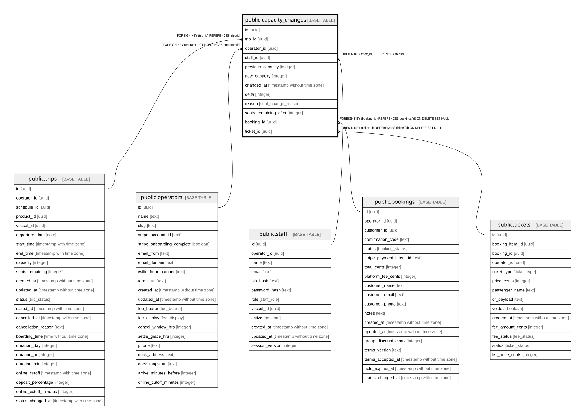

# public.capacity_changes

## Description

Ledger of every change to a trip's seats_remaining and capacity, written only by lib/inventory. sum(delta) over a trip reconciles to its seats_remaining; a recount row records drift it corrected.

## Columns

| Name                  | Type                        | Default           | Nullable | Children | Parents                                 | Comment                                                                                          |
| --------------------- | --------------------------- | ----------------- | -------- | -------- | --------------------------------------- | ------------------------------------------------------------------------------------------------ |
| id                    | uuid                        | gen_random_uuid() | false    |          |                                         |                                                                                                  |
| trip_id               | uuid                        |                   | false    |          | [public.trips](public.trips.md)         |                                                                                                  |
| operator_id           | uuid                        |                   | false    |          | [public.operators](public.operators.md) | Owning operator. Every query on this table must filter by it.                                    |
| staff_id              | uuid                        |                   | true     |          | [public.staff](public.staff.md)         | Staff member who made the change.                                                                |
| previous_capacity     | integer                     |                   | true     |          |                                         |                                                                                                  |
| new_capacity          | integer                     |                   | true     |          |                                         |                                                                                                  |
| changed_at            | timestamp without time zone | now()             | false    |          |                                         |                                                                                                  |
| delta                 | integer                     |                   | true     |          |                                         | Change to seats_remaining; negative takes seats. Null on rows written before the ledger existed. |
| reason                | seat_change_reason          |                   | true     |          |                                         | hold, release, refund, trip_cancel, capacity_edit or recount.                                    |
| seats_remaining_after | integer                     |                   | true     |          |                                         | seats_remaining once this change was applied.                                                    |
| booking_id            | uuid                        |                   | true     |          | [public.bookings](public.bookings.md)   |                                                                                                  |
| ticket_id             | uuid                        |                   | true     |          | [public.tickets](public.tickets.md)     |                                                                                                  |

## Constraints

| Name                                       | Type        | Definition                                                          |
| ------------------------------------------ | ----------- | ------------------------------------------------------------------- |
| capacity_changes_booking_id_bookings_id_fk | FOREIGN KEY | FOREIGN KEY (booking_id) REFERENCES bookings(id) ON DELETE SET NULL |
| capacity_changes_operator_id_fkey          | FOREIGN KEY | FOREIGN KEY (operator_id) REFERENCES operators(id)                  |
| capacity_changes_staff_id_fkey             | FOREIGN KEY | FOREIGN KEY (staff_id) REFERENCES staff(id)                         |
| capacity_changes_ticket_id_tickets_id_fk   | FOREIGN KEY | FOREIGN KEY (ticket_id) REFERENCES tickets(id) ON DELETE SET NULL   |
| capacity_changes_trip_id_fkey              | FOREIGN KEY | FOREIGN KEY (trip_id) REFERENCES trips(id)                          |
| capacity_changes_pkey                      | PRIMARY KEY | PRIMARY KEY (id)                                                    |

## Indexes

| Name                      | Definition                                                                              |
| ------------------------- | --------------------------------------------------------------------------------------- |
| capacity_changes_pkey     | CREATE UNIQUE INDEX capacity_changes_pkey ON public.capacity_changes USING btree (id)   |
| capacity_changes_trip_idx | CREATE INDEX capacity_changes_trip_idx ON public.capacity_changes USING btree (trip_id) |

## Relations

---

> Generated by [tbls](https://github.com/k1LoW/tbls)
