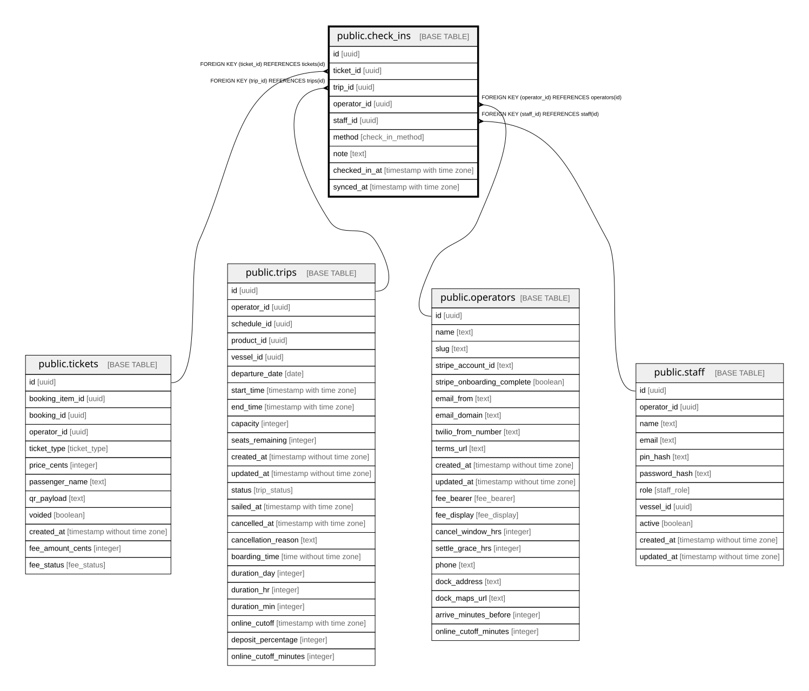

# public.check_ins

## Description

One boarding check-in per ticket. Can be recorded offline in the mate app and synced later.

## Columns

| Name          | Type                     | Default           | Nullable | Children | Parents                                 | Comment                                                          |
| ------------- | ------------------------ | ----------------- | -------- | -------- | --------------------------------------- | ---------------------------------------------------------------- |
| id            | uuid                     | gen_random_uuid() | false    |          |                                         |                                                                  |
| ticket_id     | uuid                     |                   | false    |          | [public.tickets](public.tickets.md)     |                                                                  |
| trip_id       | uuid                     |                   | false    |          | [public.trips](public.trips.md)         |                                                                  |
| operator_id   | uuid                     |                   | false    |          | [public.operators](public.operators.md) | Owning operator. Every query on this table must filter by it.    |
| staff_id      | uuid                     |                   | true     |          | [public.staff](public.staff.md)         | Mate who checked the passenger in.                               |
| method        | check_in_method          |                   | false    |          |                                         | qr (scanned), name_search, or manual.                            |
| note          | text                     |                   | true     |          |                                         | Reason for a manual override, e.g. walk-up or comp.              |
| checked_in_at | timestamp with time zone | now()             | false    |          |                                         | When the passenger was checked in on the device.                 |
| synced_at     | timestamp with time zone |                   | true     |          |                                         | When the check-in reached the server. Null = originated offline. |

## Constraints

| Name                                  | Type        | Definition                                         |
| ------------------------------------- | ----------- | -------------------------------------------------- |
| check_ins_pkey                        | PRIMARY KEY | PRIMARY KEY (id)                                   |
| check_ins_ticket_id_unique            | UNIQUE      | UNIQUE (ticket_id)                                 |
| check_ins_operator_id_operators_id_fk | FOREIGN KEY | FOREIGN KEY (operator_id) REFERENCES operators(id) |
| check_ins_staff_id_staff_id_fk        | FOREIGN KEY | FOREIGN KEY (staff_id) REFERENCES staff(id)        |
| check_ins_ticket_id_tickets_id_fk     | FOREIGN KEY | FOREIGN KEY (ticket_id) REFERENCES tickets(id)     |
| check_ins_trip_id_trips_id_fk         | FOREIGN KEY | FOREIGN KEY (trip_id) REFERENCES trips(id)         |

## Indexes

| Name                       | Definition                                                                                 |
| -------------------------- | ------------------------------------------------------------------------------------------ |
| check_ins_pkey             | CREATE UNIQUE INDEX check_ins_pkey ON public.check_ins USING btree (id)                    |
| check_ins_ticket_id_unique | CREATE UNIQUE INDEX check_ins_ticket_id_unique ON public.check_ins USING btree (ticket_id) |
| check_ins_trip_idx         | CREATE INDEX check_ins_trip_idx ON public.check_ins USING btree (trip_id)                  |

## Relations

---

> Generated by [tbls](https://github.com/k1LoW/tbls)
