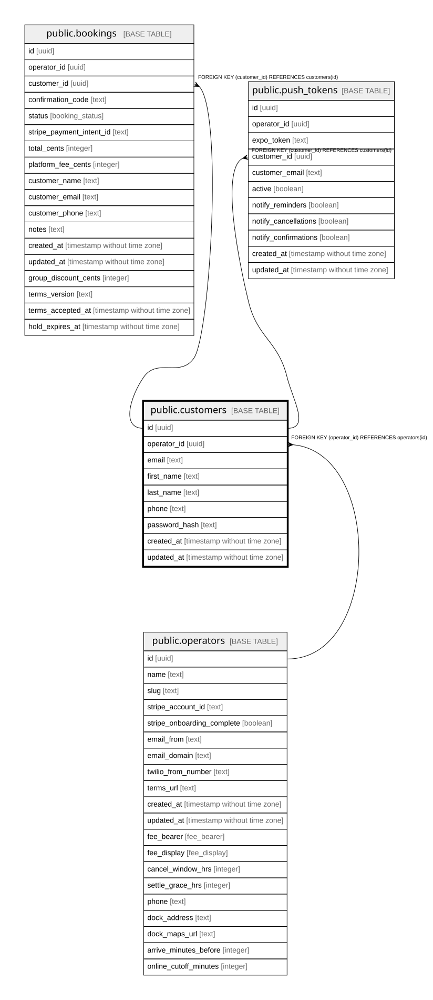

# public.customers

## Description

Consumer accounts, signed in by email one-time code. Separate from staff: incompatible auth and different data.

## Columns

| Name          | Type                        | Default           | Nullable | Children                                                                          | Parents                                 | Comment                                                       |
| ------------- | --------------------------- | ----------------- | -------- | --------------------------------------------------------------------------------- | --------------------------------------- | ------------------------------------------------------------- |
| id            | uuid                        | gen_random_uuid() | false    | [public.bookings](public.bookings.md) [public.push_tokens](public.push_tokens.md) |                                         |                                                               |
| operator_id   | uuid                        |                   | false    |                                                                                   | [public.operators](public.operators.md) | Owning operator. Every query on this table must filter by it. |
| email         | text                        |                   | false    |                                                                                   |                                         | Login identity, unique per operator.                          |
| first_name    | text                        |                   | true     |                                                                                   |                                         |                                                               |
| last_name     | text                        |                   | true     |                                                                                   |                                         |                                                               |
| phone         | text                        |                   | true     |                                                                                   |                                         |                                                               |
| password_hash | text                        |                   | true     |                                                                                   |                                         | Null = guest checkout.                                        |
| created_at    | timestamp without time zone | now()             | false    |                                                                                   |                                         |                                                               |
| updated_at    | timestamp without time zone | now()             | false    |                                                                                   |                                         |                                                               |

## Constraints

| Name                                  | Type        | Definition                                         |
| ------------------------------------- | ----------- | -------------------------------------------------- |
| customers_pkey                        | PRIMARY KEY | PRIMARY KEY (id)                                   |
| customers_operator_id_email_unique    | UNIQUE      | UNIQUE (operator_id, email)                        |
| customers_operator_id_operators_id_fk | FOREIGN KEY | FOREIGN KEY (operator_id) REFERENCES operators(id) |

## Indexes

| Name                               | Definition                                                                                                  |
| ---------------------------------- | ----------------------------------------------------------------------------------------------------------- |
| customers_pkey                     | CREATE UNIQUE INDEX customers_pkey ON public.customers USING btree (id)                                     |
| customers_operator_id_email_unique | CREATE UNIQUE INDEX customers_operator_id_email_unique ON public.customers USING btree (operator_id, email) |

## Relations

---

> Generated by [tbls](https://github.com/k1LoW/tbls)
