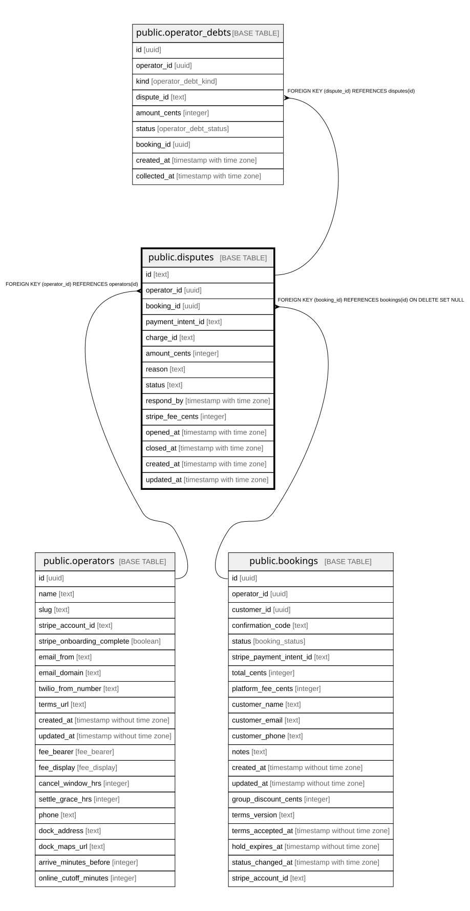

# public.disputes

## Description

Chargebacks on bookings (row 11), kept up to date by the charge.dispute.* webhook handlers. Read by the Money page and the passenger list.

## Columns

| Name              | Type                     | Default | Nullable | Children                                          | Parents                                 | Comment                                                                                                                                               |
| ----------------- | ------------------------ | ------- | -------- | ------------------------------------------------- | --------------------------------------- | ----------------------------------------------------------------------------------------------------------------------------------------------------- |
| id                | text                     |         | false    | [public.operator_debts](public.operator_debts.md) |                                         |                                                                                                                                                       |
| operator_id       | uuid                     |         | false    |                                                   | [public.operators](public.operators.md) |                                                                                                                                                       |
| booking_id        | uuid                     |         | true     |                                                   | [public.bookings](public.bookings.md)   |                                                                                                                                                       |
| payment_intent_id | text                     |         | false    |                                                   |                                         |                                                                                                                                                       |
| charge_id         | text                     |         | true     |                                                   |                                         |                                                                                                                                                       |
| amount_cents      | integer                  |         | false    |                                                   |                                         |                                                                                                                                                       |
| reason            | text                     |         | false    |                                                   |                                         |                                                                                                                                                       |
| status            | text                     |         | false    |                                                   |                                         | Stripe's dispute status: warning_* (an inquiry; no money taken), needs_response, under_review, won, lost.                                             |
| respond_by        | timestamp with time zone |         | true     |                                                   |                                         | Stripe's deadline for evidence (evidence_details.due_by).                                                                                             |
| stripe_fee_cents  | integer                  |         | true     |                                                   |                                         | Stripe's dispute fees net of any it returned, summed from the dispute's balance transactions when it closes. The operator owes this (operator_debts). |
| opened_at         | timestamp with time zone |         | false    |                                                   |                                         |                                                                                                                                                       |
| closed_at         | timestamp with time zone |         | true     |                                                   |                                         |                                                                                                                                                       |
| created_at        | timestamp with time zone | now()   | false    |                                                   |                                         |                                                                                                                                                       |
| updated_at        | timestamp with time zone | now()   | false    |                                                   |                                         |                                                                                                                                                       |

## Constraints

| Name                                 | Type        | Definition                                                          |
| ------------------------------------ | ----------- | ------------------------------------------------------------------- |
| disputes_booking_id_bookings_id_fk   | FOREIGN KEY | FOREIGN KEY (booking_id) REFERENCES bookings(id) ON DELETE SET NULL |
| disputes_operator_id_operators_id_fk | FOREIGN KEY | FOREIGN KEY (operator_id) REFERENCES operators(id)                  |
| disputes_pkey                        | PRIMARY KEY | PRIMARY KEY (id)                                                    |

## Indexes

| Name                         | Definition                                                                                        |
| ---------------------------- | ------------------------------------------------------------------------------------------------- |
| disputes_pkey                | CREATE UNIQUE INDEX disputes_pkey ON public.disputes USING btree (id)                             |
| disputes_operator_opened_idx | CREATE INDEX disputes_operator_opened_idx ON public.disputes USING btree (operator_id, opened_at) |
| disputes_booking_idx         | CREATE INDEX disputes_booking_idx ON public.disputes USING btree (booking_id)                     |

## Relations

---

> Generated by [tbls](https://github.com/k1LoW/tbls)
