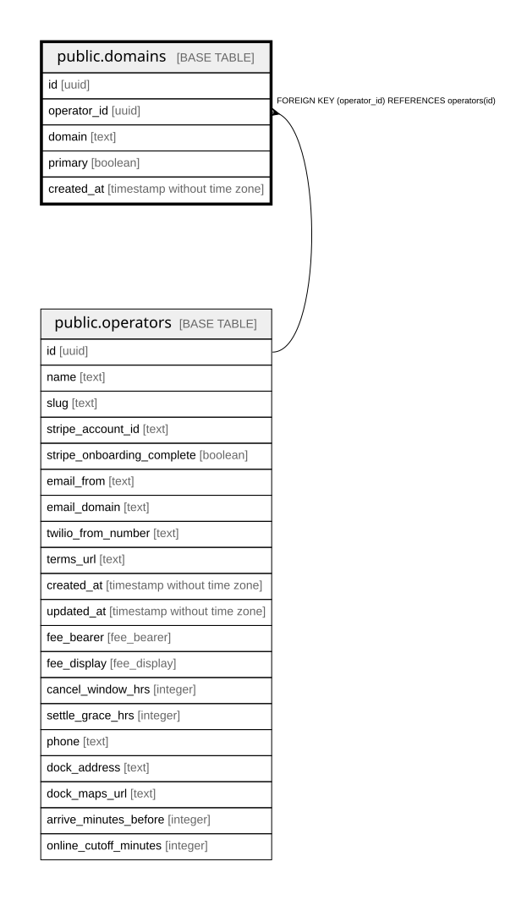

# public.domains

## Description

Hostname to operator mapping used by the Edge middleware in platform mode. An operator may have several domains.

## Columns

| Name        | Type                        | Default           | Nullable | Children | Parents                                 | Comment                                                       |
| ----------- | --------------------------- | ----------------- | -------- | -------- | --------------------------------------- | ------------------------------------------------------------- |
| id          | uuid                        | gen_random_uuid() | false    |          |                                         |                                                               |
| operator_id | uuid                        |                   | false    |          | [public.operators](public.operators.md) | Owning operator. Every query on this table must filter by it. |
| domain      | text                        |                   | false    |          |                                         | Hostname, e.g. youroperator.com.                              |
| primary     | boolean                     | false             | false    |          |                                         | The operator's canonical domain.                              |
| created_at  | timestamp without time zone | now()             | false    |          |                                         |                                                               |

## Constraints

| Name                                | Type        | Definition                                         |
| ----------------------------------- | ----------- | -------------------------------------------------- |
| domains_pkey                        | PRIMARY KEY | PRIMARY KEY (id)                                   |
| domains_domain_unique               | UNIQUE      | UNIQUE (domain)                                    |
| domains_operator_id_operators_id_fk | FOREIGN KEY | FOREIGN KEY (operator_id) REFERENCES operators(id) |

## Indexes

| Name                  | Definition                                                                       |
| --------------------- | -------------------------------------------------------------------------------- |
| domains_pkey          | CREATE UNIQUE INDEX domains_pkey ON public.domains USING btree (id)              |
| domains_domain_unique | CREATE UNIQUE INDEX domains_domain_unique ON public.domains USING btree (domain) |

## Relations

---

> Generated by [tbls](https://github.com/k1LoW/tbls)
