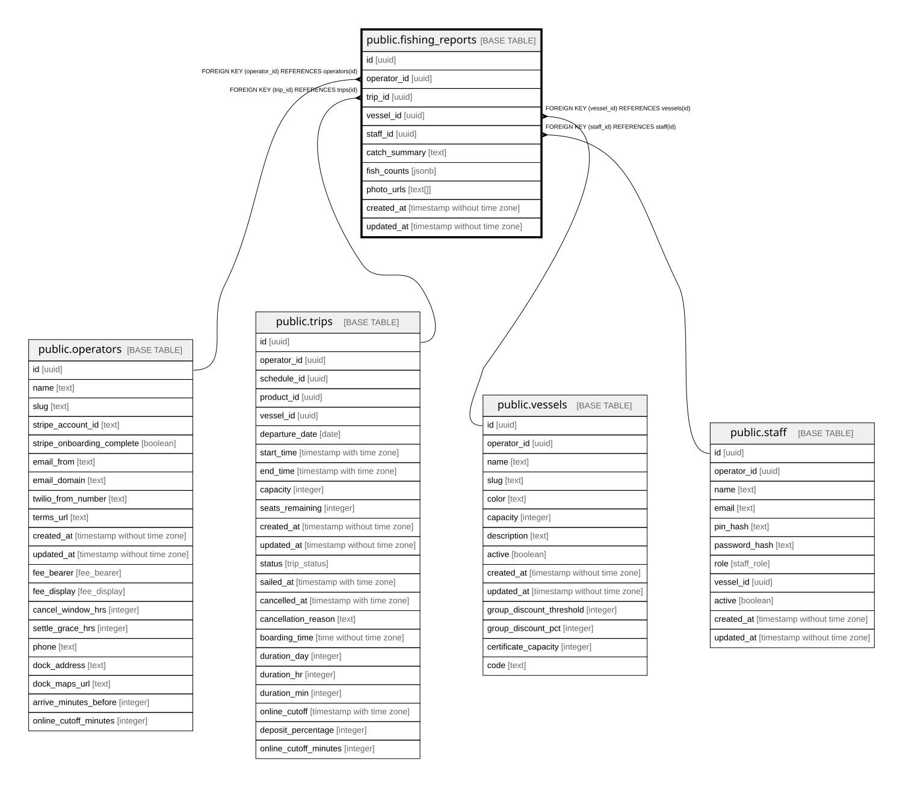

# public.fishing_reports

## Description

Captain's report after a trip. One per trip.

## Columns

| Name          | Type                        | Default           | Nullable | Children | Parents                                 | Comment                                                       |
| ------------- | --------------------------- | ----------------- | -------- | -------- | --------------------------------------- | ------------------------------------------------------------- |
| id            | uuid                        | gen_random_uuid() | false    |          |                                         |                                                               |
| operator_id   | uuid                        |                   | false    |          | [public.operators](public.operators.md) | Owning operator. Every query on this table must filter by it. |
| trip_id       | uuid                        |                   | false    |          | [public.trips](public.trips.md)         |                                                               |
| vessel_id     | uuid                        |                   | false    |          | [public.vessels](public.vessels.md)     |                                                               |
| staff_id      | uuid                        |                   | true     |          | [public.staff](public.staff.md)         | Who posted the report.                                        |
| catch_summary | text                        |                   | true     |          |                                         | Free-text summary of the day.                                 |
| fish_counts   | jsonb                       | '[]'::jsonb       | false    |          |                                         | JSON array of {species, count}.                               |
| photo_urls    | text[]                      | '{}'::text[]      | false    |          |                                         | Vercel Blob URLs of catch photos.                             |
| created_at    | timestamp without time zone | now()             | false    |          |                                         |                                                               |
| updated_at    | timestamp without time zone | now()             | false    |          |                                         |                                                               |

## Constraints

| Name                                        | Type        | Definition                                         |
| ------------------------------------------- | ----------- | -------------------------------------------------- |
| fishing_reports_operator_id_operators_id_fk | FOREIGN KEY | FOREIGN KEY (operator_id) REFERENCES operators(id) |
| fishing_reports_staff_id_staff_id_fk        | FOREIGN KEY | FOREIGN KEY (staff_id) REFERENCES staff(id)        |
| fishing_reports_trip_id_trips_id_fk         | FOREIGN KEY | FOREIGN KEY (trip_id) REFERENCES trips(id)         |
| fishing_reports_vessel_id_vessels_id_fk     | FOREIGN KEY | FOREIGN KEY (vessel_id) REFERENCES vessels(id)     |
| fishing_reports_pkey                        | PRIMARY KEY | PRIMARY KEY (id)                                   |
| fishing_reports_trip_id_unique              | UNIQUE      | UNIQUE (trip_id)                                   |

## Indexes

| Name                           | Definition                                                                                         |
| ------------------------------ | -------------------------------------------------------------------------------------------------- |
| fishing_reports_pkey           | CREATE UNIQUE INDEX fishing_reports_pkey ON public.fishing_reports USING btree (id)                |
| fishing_reports_trip_id_unique | CREATE UNIQUE INDEX fishing_reports_trip_id_unique ON public.fishing_reports USING btree (trip_id) |
| fishing_reports_operator_idx   | CREATE INDEX fishing_reports_operator_idx ON public.fishing_reports USING btree (operator_id)      |
| fishing_reports_vessel_idx     | CREATE INDEX fishing_reports_vessel_idx ON public.fishing_reports USING btree (vessel_id)          |

## Relations

---

> Generated by [tbls](https://github.com/k1LoW/tbls)
