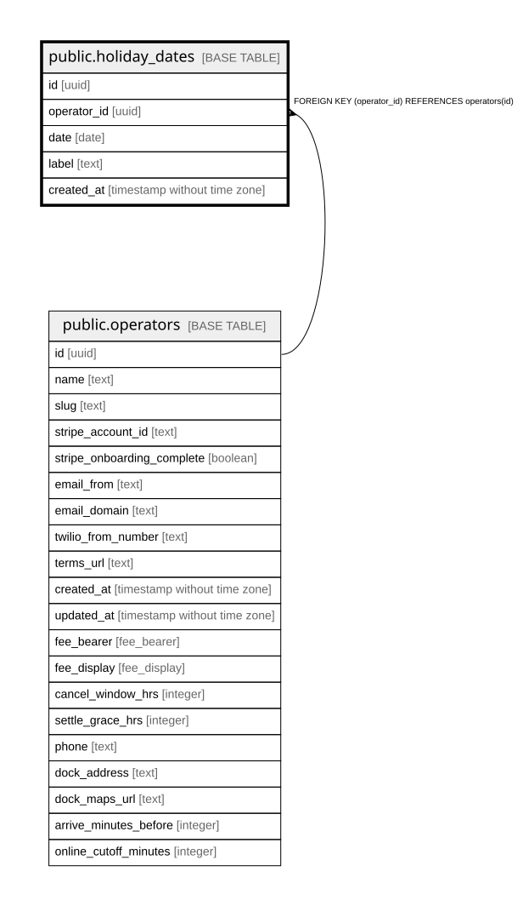

# public.holiday_dates

## Description

Dates meant to be priced as weekend/holiday regardless of day of week (e.g. Labor Day, July 4th). Not yet read by booking or pricing.

## Columns

| Name        | Type                        | Default           | Nullable | Children | Parents                                 | Comment                                                       |
| ----------- | --------------------------- | ----------------- | -------- | -------- | --------------------------------------- | ------------------------------------------------------------- |
| id          | uuid                        | gen_random_uuid() | false    |          |                                         |                                                               |
| operator_id | uuid                        |                   | false    |          | [public.operators](public.operators.md) | Owning operator. Every query on this table must filter by it. |
| date        | date                        |                   | false    |          |                                         |                                                               |
| label       | text                        |                   | false    |          |                                         | Display name, e.g. Labor Day 2026.                            |
| created_at  | timestamp without time zone | now()             | false    |          |                                         |                                                               |

## Constraints

| Name                                      | Type        | Definition                                         |
| ----------------------------------------- | ----------- | -------------------------------------------------- |
| holiday_dates_operator_id_operators_id_fk | FOREIGN KEY | FOREIGN KEY (operator_id) REFERENCES operators(id) |
| holiday_dates_pkey                        | PRIMARY KEY | PRIMARY KEY (id)                                   |
| holiday_dates_operator_id_date_unique     | UNIQUE      | UNIQUE (operator_id, date)                         |

## Indexes

| Name                                  | Definition                                                                                                        |
| ------------------------------------- | ----------------------------------------------------------------------------------------------------------------- |
| holiday_dates_pkey                    | CREATE UNIQUE INDEX holiday_dates_pkey ON public.holiday_dates USING btree (id)                                   |
| holiday_dates_operator_id_date_unique | CREATE UNIQUE INDEX holiday_dates_operator_id_date_unique ON public.holiday_dates USING btree (operator_id, date) |

## Relations

---

> Generated by [tbls](https://github.com/k1LoW/tbls)
