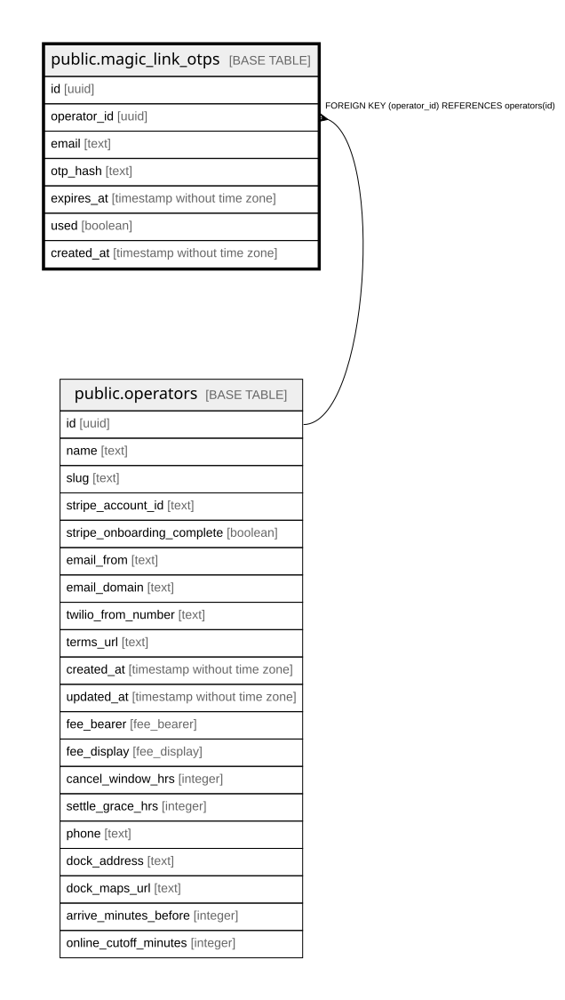

# public.magic_link_otps

## Description

6-digit one-time sign-in codes for customers. Expire after 15 minutes.

## Columns

| Name        | Type                        | Default           | Nullable | Children | Parents                                 | Comment                                                       |
| ----------- | --------------------------- | ----------------- | -------- | -------- | --------------------------------------- | ------------------------------------------------------------- |
| id          | uuid                        | gen_random_uuid() | false    |          |                                         |                                                               |
| operator_id | uuid                        |                   | false    |          | [public.operators](public.operators.md) | Owning operator. Every query on this table must filter by it. |
| email       | text                        |                   | false    |          |                                         |                                                               |
| otp_hash    | text                        |                   | false    |          |                                         | bcrypt hash of the 6-digit code.                              |
| expires_at  | timestamp without time zone |                   | false    |          |                                         |                                                               |
| used        | boolean                     | false             | false    |          |                                         | True once the code has been redeemed.                         |
| created_at  | timestamp without time zone | now()             | false    |          |                                         |                                                               |

## Constraints

| Name                                        | Type        | Definition                                         |
| ------------------------------------------- | ----------- | -------------------------------------------------- |
| magic_link_otps_operator_id_operators_id_fk | FOREIGN KEY | FOREIGN KEY (operator_id) REFERENCES operators(id) |
| magic_link_otps_pkey                        | PRIMARY KEY | PRIMARY KEY (id)                                   |

## Indexes

| Name                 | Definition                                                                          |
| -------------------- | ----------------------------------------------------------------------------------- |
| magic_link_otps_pkey | CREATE UNIQUE INDEX magic_link_otps_pkey ON public.magic_link_otps USING btree (id) |

## Relations

---

> Generated by [tbls](https://github.com/k1LoW/tbls)
