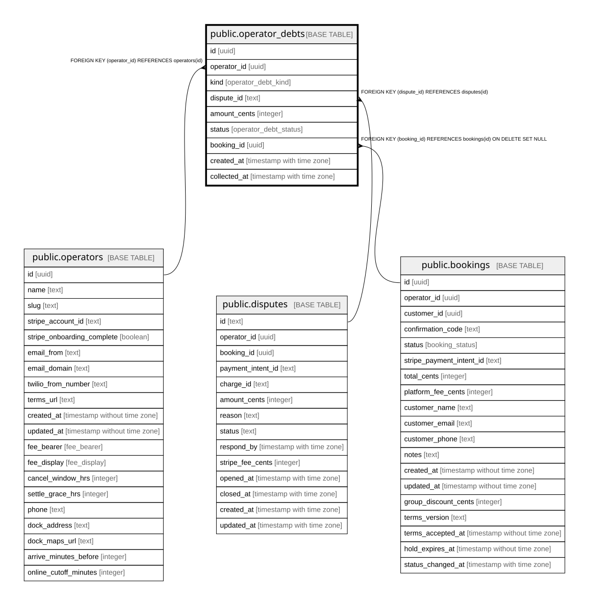

# public.operator_debts

## Description

Money an operator owes the platform: the Stripe fee on a chargeback (row 11). Collected by adding it to the platform fee on the operator's next booking, because Standard connected accounts can't be debited.

## Columns

| Name         | Type                     | Default                      | Nullable | Children | Parents                                 | Comment                                                                                                                                 |
| ------------ | ------------------------ | ---------------------------- | -------- | -------- | --------------------------------------- | --------------------------------------------------------------------------------------------------------------------------------------- |
| id           | uuid                     | gen_random_uuid()            | false    |          |                                         |                                                                                                                                         |
| operator_id  | uuid                     |                              | false    |          | [public.operators](public.operators.md) |                                                                                                                                         |
| kind         | operator_debt_kind       |                              | false    |          |                                         |                                                                                                                                         |
| dispute_id   | text                     |                              | true     |          | [public.disputes](public.disputes.md)   |                                                                                                                                         |
| amount_cents | integer                  |                              | false    |          |                                         |                                                                                                                                         |
| status       | operator_debt_status     | 'owed'::operator_debt_status | false    |          |                                         | owed (waiting for a booking), reserved (added to booking_id's platform fee, not yet paid), collected (booking_id's payment carried it). |
| booking_id   | uuid                     |                              | true     |          | [public.bookings](public.bookings.md)   | The booking whose platform fee carries the debt, while reserved or collected.                                                           |
| created_at   | timestamp with time zone | now()                        | false    |          |                                         |                                                                                                                                         |
| collected_at | timestamp with time zone |                              | true     |          |                                         |                                                                                                                                         |

## Constraints

| Name                                       | Type        | Definition                                                          |
| ------------------------------------------ | ----------- | ------------------------------------------------------------------- |
| operator_debts_booking_id_bookings_id_fk   | FOREIGN KEY | FOREIGN KEY (booking_id) REFERENCES bookings(id) ON DELETE SET NULL |
| operator_debts_operator_id_operators_id_fk | FOREIGN KEY | FOREIGN KEY (operator_id) REFERENCES operators(id)                  |
| operator_debts_dispute_id_disputes_id_fk   | FOREIGN KEY | FOREIGN KEY (dispute_id) REFERENCES disputes(id)                    |
| operator_debts_pkey                        | PRIMARY KEY | PRIMARY KEY (id)                                                    |
| operator_debts_dispute_id_unique           | UNIQUE      | UNIQUE (dispute_id)                                                 |

## Indexes

| Name                               | Definition                                                                                                             |
| ---------------------------------- | ---------------------------------------------------------------------------------------------------------------------- |
| operator_debts_pkey                | CREATE UNIQUE INDEX operator_debts_pkey ON public.operator_debts USING btree (id)                                      |
| operator_debts_dispute_id_unique   | CREATE UNIQUE INDEX operator_debts_dispute_id_unique ON public.operator_debts USING btree (dispute_id)                 |
| operator_debts_operator_status_idx | CREATE INDEX operator_debts_operator_status_idx ON public.operator_debts USING btree (operator_id, status, created_at) |
| operator_debts_booking_idx         | CREATE INDEX operator_debts_booking_idx ON public.operator_debts USING btree (booking_id)                              |

## Relations

---

> Generated by [tbls](https://github.com/k1LoW/tbls)
