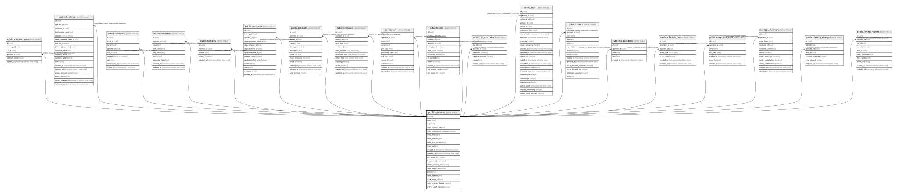

# public.operators

## Description

One row per fishing boat business (tenant root). A single-deploy install has exactly one row; the centralized platform has one per operator, resolved from the request hostname via domains.

## Columns

| Name                       | Type                        | Default                 | Nullable | Children                                                                                                                                                                                                                                                                                                                                                                                                                                                                                                                                                                                                                                                                                                                                                                                                                              | Parents | Comment                                                                                                                                             |
| -------------------------- | --------------------------- | ----------------------- | -------- | ------------------------------------------------------------------------------------------------------------------------------------------------------------------------------------------------------------------------------------------------------------------------------------------------------------------------------------------------------------------------------------------------------------------------------------------------------------------------------------------------------------------------------------------------------------------------------------------------------------------------------------------------------------------------------------------------------------------------------------------------------------------------------------------------------------------------------------- | ------- | --------------------------------------------------------------------------------------------------------------------------------------------------- |
| id                         | uuid                        | gen_random_uuid()       | false    | [public.booking_items](public.booking_items.md) [public.bookings](public.bookings.md) [public.check_ins](public.check_ins.md) [public.customers](public.customers.md) [public.domains](public.domains.md) [public.payments](public.payments.md) [public.products](public.products.md) [public.schedules](public.schedules.md) [public.staff](public.staff.md) [public.tickets](public.tickets.md) [public.trip_overrides](public.trip_overrides.md) [public.trips](public.trips.md) [public.vessels](public.vessels.md) [public.holiday_dates](public.holiday_dates.md) [public.schedule_prices](public.schedule_prices.md) [public.magic_link_otps](public.magic_link_otps.md) [public.push_tokens](public.push_tokens.md) [public.capacity_changes](public.capacity_changes.md) [public.fishing_reports](public.fishing_reports.md) |         |                                                                                                                                                     |
| name                       | text                        |                         | false    |                                                                                                                                                                                                                                                                                                                                                                                                                                                                                                                                                                                                                                                                                                                                                                                                                                       |         |                                                                                                                                                     |
| slug                       | text                        |                         | false    |                                                                                                                                                                                                                                                                                                                                                                                                                                                                                                                                                                                                                                                                                                                                                                                                                                       |         | URL-safe unique identifier.                                                                                                                         |
| stripe_account_id          | text                        |                         | true     |                                                                                                                                                                                                                                                                                                                                                                                                                                                                                                                                                                                                                                                                                                                                                                                                                                       |         | Stripe Connect connected account. Destination charges transfer ticket revenue here.                                                                 |
| stripe_onboarding_complete | boolean                     | false                   | false    |                                                                                                                                                                                                                                                                                                                                                                                                                                                                                                                                                                                                                                                                                                                                                                                                                                       |         | True once the operator has finished Stripe Connect onboarding and can take payments.                                                                |
| email_from                 | text                        |                         | false    |                                                                                                                                                                                                                                                                                                                                                                                                                                                                                                                                                                                                                                                                                                                                                                                                                                       |         | Sender address for customer emails, e.g. office@youroperator.com.                                                                                   |
| email_domain               | text                        |                         | false    |                                                                                                                                                                                                                                                                                                                                                                                                                                                                                                                                                                                                                                                                                                                                                                                                                                       |         | Domain the sender address belongs to, e.g. youroperator.com.                                                                                        |
| twilio_from_number         | text                        |                         | true     |                                                                                                                                                                                                                                                                                                                                                                                                                                                                                                                                                                                                                                                                                                                                                                                                                                       |         | SMS sender number. Null = SMS not configured.                                                                                                       |
| terms_url                  | text                        |                         | true     |                                                                                                                                                                                                                                                                                                                                                                                                                                                                                                                                                                                                                                                                                                                                                                                                                                       |         | Link to the operator's terms and conditions shown at checkout.                                                                                      |
| created_at                 | timestamp without time zone | now()                   | false    |                                                                                                                                                                                                                                                                                                                                                                                                                                                                                                                                                                                                                                                                                                                                                                                                                                       |         |                                                                                                                                                     |
| updated_at                 | timestamp without time zone | now()                   | false    |                                                                                                                                                                                                                                                                                                                                                                                                                                                                                                                                                                                                                                                                                                                                                                                                                                       |         |                                                                                                                                                     |
| fee_bearer                 | fee_bearer                  | 'passenger'::fee_bearer | false    |                                                                                                                                                                                                                                                                                                                                                                                                                                                                                                                                                                                                                                                                                                                                                                                                                                       |         | Who pays the per-ticket platform fee: passenger (added to the ticket price) or operator (absorbed).                                                 |
| fee_display                | fee_display                 | 'itemized'::fee_display | false    |                                                                                                                                                                                                                                                                                                                                                                                                                                                                                                                                                                                                                                                                                                                                                                                                                                       |         | How the platform fee is shown: itemized as a separate line, or folded into the ticket price.                                                        |
| cancel_window_hrs          | integer                     | 48                      | false    |                                                                                                                                                                                                                                                                                                                                                                                                                                                                                                                                                                                                                                                                                                                                                                                                                                       |         | How many hours before departure a customer can still self-cancel.                                                                                   |
| settle_grace_hrs           | integer                     | 48                      | false    |                                                                                                                                                                                                                                                                                                                                                                                                                                                                                                                                                                                                                                                                                                                                                                                                                                       |         | Hours after departure before ticket fees move from held to earned.                                                                                  |
| phone                      | text                        |                         | true     |                                                                                                                                                                                                                                                                                                                                                                                                                                                                                                                                                                                                                                                                                                                                                                                                                                       |         |                                                                                                                                                     |
| dock_address               | text                        |                         | true     |                                                                                                                                                                                                                                                                                                                                                                                                                                                                                                                                                                                                                                                                                                                                                                                                                                       |         | Where passengers board, shown on confirmations and boarding passes.                                                                                 |
| dock_maps_url              | text                        |                         | true     |                                                                                                                                                                                                                                                                                                                                                                                                                                                                                                                                                                                                                                                                                                                                                                                                                                       |         | Map link for the dock.                                                                                                                              |
| arrive_minutes_before      | integer                     |                         | true     |                                                                                                                                                                                                                                                                                                                                                                                                                                                                                                                                                                                                                                                                                                                                                                                                                                       |         | How early passengers should arrive. Null = no arrive-early note shown.                                                                              |
| online_cutoff_minutes      | integer                     | 30                      | false    |                                                                                                                                                                                                                                                                                                                                                                                                                                                                                                                                                                                                                                                                                                                                                                                                                                       |         | Online sales stop this many minutes before departure. 0 = sales run right up to departure. A trip can override it with trips.online_cutoff_minutes. |

## Constraints

| Name                                  | Type        | Definition                           |
| ------------------------------------- | ----------- | ------------------------------------ |
| operators_online_cutoff_minutes_check | CHECK       | CHECK ((online_cutoff_minutes >= 0)) |
| operators_pkey                        | PRIMARY KEY | PRIMARY KEY (id)                     |
| operators_slug_unique                 | UNIQUE      | UNIQUE (slug)                        |

## Indexes

| Name                  | Definition                                                                       |
| --------------------- | -------------------------------------------------------------------------------- |
| operators_pkey        | CREATE UNIQUE INDEX operators_pkey ON public.operators USING btree (id)          |
| operators_slug_unique | CREATE UNIQUE INDEX operators_slug_unique ON public.operators USING btree (slug) |

## Relations

---

> Generated by [tbls](https://github.com/k1LoW/tbls)
