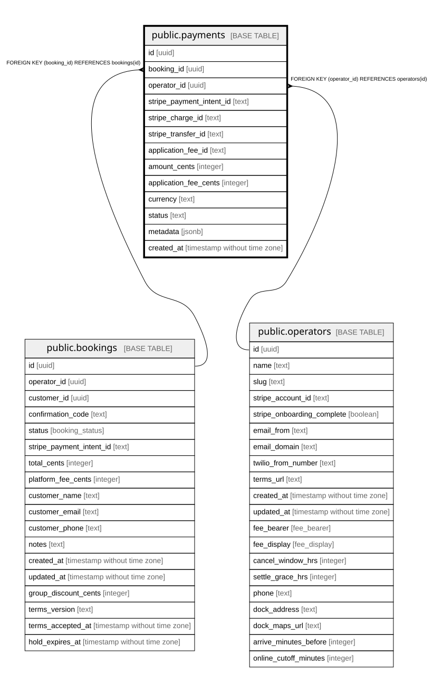

# public.payments

## Description

Stripe payment record, written when payment_intent.succeeded arrives.

## Columns

| Name                     | Type                        | Default           | Nullable | Children | Parents                                 | Comment                                                       |
| ------------------------ | --------------------------- | ----------------- | -------- | -------- | --------------------------------------- | ------------------------------------------------------------- |
| id                       | uuid                        | gen_random_uuid() | false    |          |                                         |                                                               |
| booking_id               | uuid                        |                   | false    |          | [public.bookings](public.bookings.md)   |                                                               |
| operator_id              | uuid                        |                   | false    |          | [public.operators](public.operators.md) | Owning operator. Every query on this table must filter by it. |
| stripe_payment_intent_id | text                        |                   | false    |          |                                         |                                                               |
| stripe_charge_id         | text                        |                   | true     |          |                                         | Stripe Charge created by the PaymentIntent.                   |
| stripe_transfer_id       | text                        |                   | true     |          |                                         | Transfer to the operator's connected account.                 |
| application_fee_id       | text                        |                   | true     |          |                                         | Stripe application fee object for the platform fee.           |
| amount_cents             | integer                     |                   | false    |          |                                         | Amount charged, in cents.                                     |
| application_fee_cents    | integer                     |                   | false    |          |                                         | Platform fee taken, in cents.                                 |
| currency                 | text                        | 'usd'::text       | false    |          |                                         |                                                               |
| status                   | text                        |                   | false    |          |                                         | Stripe PaymentIntent status.                                  |
| metadata                 | jsonb                       |                   | true     |          |                                         |                                                               |
| created_at               | timestamp without time zone | now()             | false    |          |                                         |                                                               |

## Constraints

| Name                                     | Type        | Definition                                         |
| ---------------------------------------- | ----------- | -------------------------------------------------- |
| payments_booking_id_bookings_id_fk       | FOREIGN KEY | FOREIGN KEY (booking_id) REFERENCES bookings(id)   |
| payments_operator_id_operators_id_fk     | FOREIGN KEY | FOREIGN KEY (operator_id) REFERENCES operators(id) |
| payments_pkey                            | PRIMARY KEY | PRIMARY KEY (id)                                   |
| payments_booking_id_unique               | UNIQUE      | UNIQUE (booking_id)                                |
| payments_stripe_payment_intent_id_unique | UNIQUE      | UNIQUE (stripe_payment_intent_id)                  |

## Indexes

| Name                                     | Definition                                                                                                             |
| ---------------------------------------- | ---------------------------------------------------------------------------------------------------------------------- |
| payments_pkey                            | CREATE UNIQUE INDEX payments_pkey ON public.payments USING btree (id)                                                  |
| payments_booking_id_unique               | CREATE UNIQUE INDEX payments_booking_id_unique ON public.payments USING btree (booking_id)                             |
| payments_stripe_payment_intent_id_unique | CREATE UNIQUE INDEX payments_stripe_payment_intent_id_unique ON public.payments USING btree (stripe_payment_intent_id) |

## Relations

---

> Generated by [tbls](https://github.com/k1LoW/tbls)
