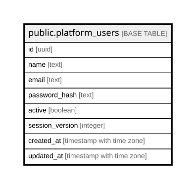

# public.platform_users

## Description

Named accounts for the platform console (row 12). PLATFORM_SECRET creates only the first one.

## Columns

| Name            | Type                     | Default           | Nullable | Children | Parents | Comment                                                                                                  |
| --------------- | ------------------------ | ----------------- | -------- | -------- | ------- | -------------------------------------------------------------------------------------------------------- |
| id              | uuid                     | gen_random_uuid() | false    |          |         |                                                                                                          |
| name            | text                     |                   | false    |          |         |                                                                                                          |
| email           | text                     |                   | false    |          |         |                                                                                                          |
| password_hash   | text                     |                   | false    |          |         |                                                                                                          |
| active          | boolean                  | true              | false    |          |         |                                                                                                          |
| session_version | integer                  | 0                 | false    |          |         | Sealed into the platform session and compared on every request; deactivation or a new password adds one. |
| created_at      | timestamp with time zone | now()             | false    |          |         |                                                                                                          |
| updated_at      | timestamp with time zone | now()             | false    |          |         |                                                                                                          |

## Constraints

| Name                        | Type        | Definition       |
| --------------------------- | ----------- | ---------------- |
| platform_users_pkey         | PRIMARY KEY | PRIMARY KEY (id) |
| platform_users_email_unique | UNIQUE      | UNIQUE (email)   |

## Indexes

| Name                        | Definition                                                                                   |
| --------------------------- | -------------------------------------------------------------------------------------------- |
| platform_users_pkey         | CREATE UNIQUE INDEX platform_users_pkey ON public.platform_users USING btree (id)            |
| platform_users_email_unique | CREATE UNIQUE INDEX platform_users_email_unique ON public.platform_users USING btree (email) |

## Relations

---

> Generated by [tbls](https://github.com/k1LoW/tbls)
