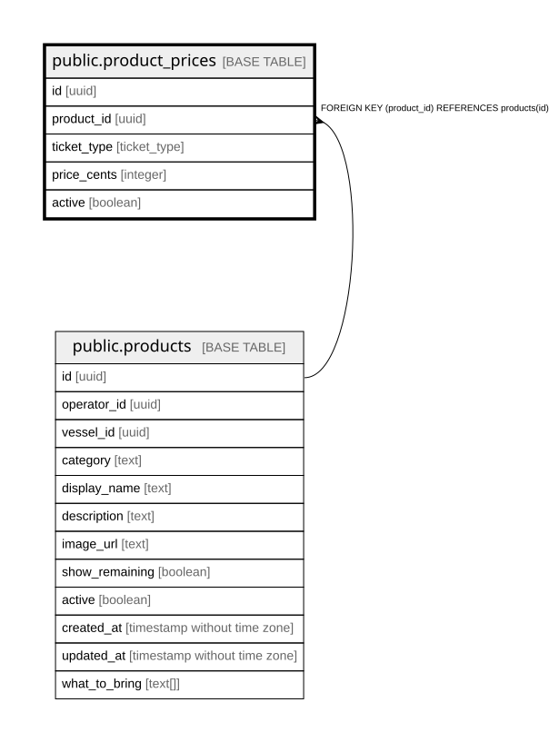

# public.product_prices

## Description

Default price per ticket type for a product. Adult, child and senior each get a row.

## Columns

| Name        | Type        | Default           | Nullable | Children | Parents                               | Comment                                    |
| ----------- | ----------- | ----------------- | -------- | -------- | ------------------------------------- | ------------------------------------------ |
| id          | uuid        | gen_random_uuid() | false    |          |                                       |                                            |
| product_id  | uuid        |                   | false    |          | [public.products](public.products.md) |                                            |
| ticket_type | ticket_type |                   | false    |          |                                       |                                            |
| price_cents | integer     |                   | false    |          |                                       | Ticket price in cents, e.g. 6800 = $68.00. |
| active      | boolean     | true              | false    |          |                                       |                                            |

## Constraints

| Name                                         | Type        | Definition                                       |
| -------------------------------------------- | ----------- | ------------------------------------------------ |
| product_prices_pkey                          | PRIMARY KEY | PRIMARY KEY (id)                                 |
| product_prices_product_id_ticket_type_unique | UNIQUE      | UNIQUE (product_id, ticket_type)                 |
| product_prices_product_id_products_id_fk     | FOREIGN KEY | FOREIGN KEY (product_id) REFERENCES products(id) |

## Indexes

| Name                                         | Definition                                                                                                                      |
| -------------------------------------------- | ------------------------------------------------------------------------------------------------------------------------------- |
| product_prices_pkey                          | CREATE UNIQUE INDEX product_prices_pkey ON public.product_prices USING btree (id)                                               |
| product_prices_product_id_ticket_type_unique | CREATE UNIQUE INDEX product_prices_product_id_ticket_type_unique ON public.product_prices USING btree (product_id, ticket_type) |

## Relations

---

> Generated by [tbls](https://github.com/k1LoW/tbls)
