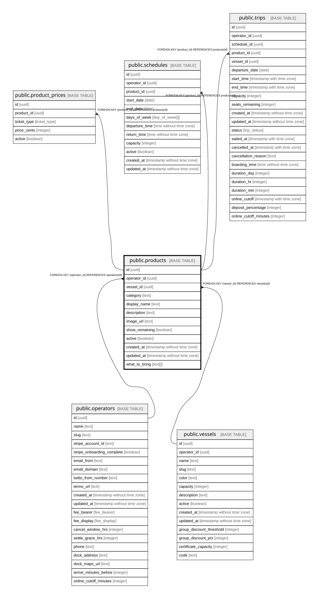

# public.products

## Description

Trip type sold on a vessel, e.g. Sea Bass Fishing Express.

## Columns

| Name           | Type                        | Default           | Nullable | Children                                                                                                                  | Parents                                 | Comment                                                       |
| -------------- | --------------------------- | ----------------- | -------- | ------------------------------------------------------------------------------------------------------------------------- | --------------------------------------- | ------------------------------------------------------------- |
| id             | uuid                        | gen_random_uuid() | false    | [public.product_prices](public.product_prices.md) [public.schedules](public.schedules.md) [public.trips](public.trips.md) |                                         |                                                               |
| operator_id    | uuid                        |                   | false    |                                                                                                                           | [public.operators](public.operators.md) | Owning operator. Every query on this table must filter by it. |
| vessel_id      | uuid                        |                   | false    |                                                                                                                           | [public.vessels](public.vessels.md)     |                                                               |
| category       | text                        |                   | false    |                                                                                                                           |                                         | Fish species label, e.g. Sea Bass, Fluke, Night Stripers.     |
| display_name   | text                        |                   | false    |                                                                                                                           |                                         | Full name shown to customers, e.g. Sea Bass Fishing Express.  |
| description    | text                        |                   | true     |                                                                                                                           |                                         |                                                               |
| image_url      | text                        |                   | true     |                                                                                                                           |                                         |                                                               |
| show_remaining | boolean                     | false             | false    |                                                                                                                           |                                         | Show customers how many seats are left.                       |
| active         | boolean                     | true              | false    |                                                                                                                           |                                         |                                                               |
| created_at     | timestamp without time zone | now()             | false    |                                                                                                                           |                                         |                                                               |
| updated_at     | timestamp without time zone | now()             | false    |                                                                                                                           |                                         |                                                               |
| what_to_bring  | text[]                      | '{}'::text[]      | false    |                                                                                                                           |                                         | Checklist shown to passengers before the trip.                |

## Constraints

| Name                                 | Type        | Definition                                         |
| ------------------------------------ | ----------- | -------------------------------------------------- |
| products_operator_id_operators_id_fk | FOREIGN KEY | FOREIGN KEY (operator_id) REFERENCES operators(id) |
| products_pkey                        | PRIMARY KEY | PRIMARY KEY (id)                                   |
| products_vessel_id_vessels_id_fk     | FOREIGN KEY | FOREIGN KEY (vessel_id) REFERENCES vessels(id)     |

## Indexes

| Name          | Definition                                                            |
| ------------- | --------------------------------------------------------------------- |
| products_pkey | CREATE UNIQUE INDEX products_pkey ON public.products USING btree (id) |

## Relations

---

> Generated by [tbls](https://github.com/k1LoW/tbls)
