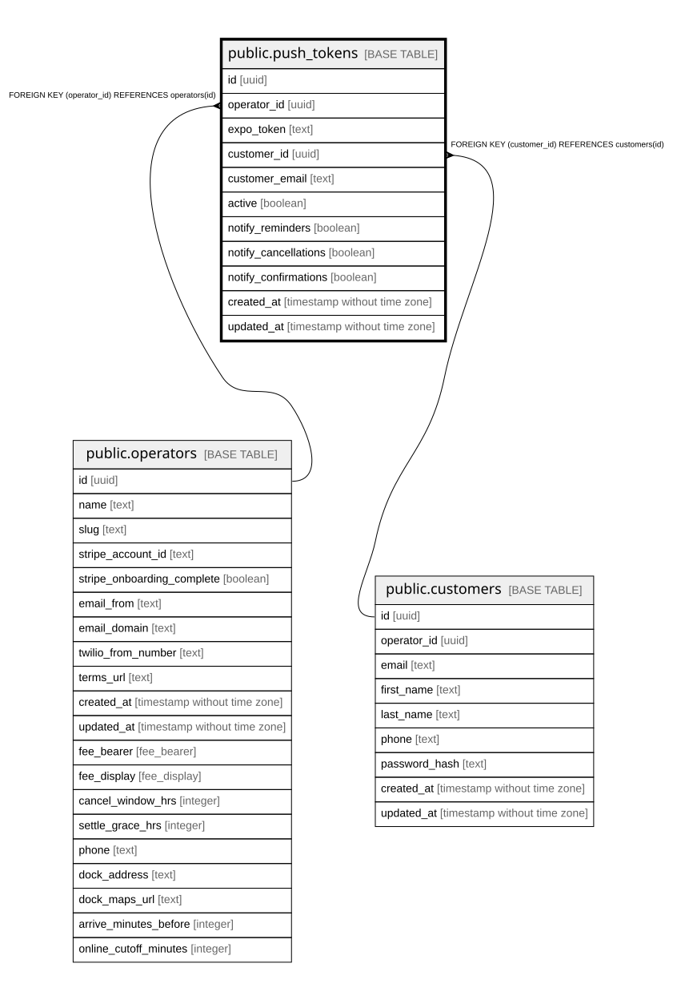

# public.push_tokens

## Description

Expo push tokens for customer devices, used for confirmation, reminder and cancellation pushes.

## Columns

| Name                 | Type                        | Default           | Nullable | Children | Parents                                 | Comment                                                                         |
| -------------------- | --------------------------- | ----------------- | -------- | -------- | --------------------------------------- | ------------------------------------------------------------------------------- |
| id                   | uuid                        | gen_random_uuid() | false    |          |                                         |                                                                                 |
| operator_id          | uuid                        |                   | false    |          | [public.operators](public.operators.md) | Owning operator. Every query on this table must filter by it.                   |
| expo_token           | text                        |                   | false    |          |                                         | Expo push token for one device.                                                 |
| customer_id          | uuid                        |                   | true     |          | [public.customers](public.customers.md) |                                                                                 |
| customer_email       | text                        |                   | true     |          |                                         | Denormalized so pushes can reach guests without a customer row.                 |
| active               | boolean                     | true              | false    |          |                                         | False once the device unregisters its token. Only active tokens receive pushes. |
| notify_reminders     | boolean                     | true              | false    |          |                                         |                                                                                 |
| notify_cancellations | boolean                     | true              | false    |          |                                         |                                                                                 |
| notify_confirmations | boolean                     | true              | false    |          |                                         |                                                                                 |
| created_at           | timestamp without time zone | now()             | false    |          |                                         |                                                                                 |
| updated_at           | timestamp without time zone | now()             | false    |          |                                         |                                                                                 |

## Constraints

| Name                                      | Type        | Definition                                         |
| ----------------------------------------- | ----------- | -------------------------------------------------- |
| push_tokens_customer_id_customers_id_fk   | FOREIGN KEY | FOREIGN KEY (customer_id) REFERENCES customers(id) |
| push_tokens_operator_id_operators_id_fk   | FOREIGN KEY | FOREIGN KEY (operator_id) REFERENCES operators(id) |
| push_tokens_pkey                          | PRIMARY KEY | PRIMARY KEY (id)                                   |
| push_tokens_operator_id_expo_token_unique | UNIQUE      | UNIQUE (operator_id, expo_token)                   |

## Indexes

| Name                                      | Definition                                                                                                                |
| ----------------------------------------- | ------------------------------------------------------------------------------------------------------------------------- |
| push_tokens_pkey                          | CREATE UNIQUE INDEX push_tokens_pkey ON public.push_tokens USING btree (id)                                               |
| push_tokens_operator_id_expo_token_unique | CREATE UNIQUE INDEX push_tokens_operator_id_expo_token_unique ON public.push_tokens USING btree (operator_id, expo_token) |

## Relations

---

> Generated by [tbls](https://github.com/k1LoW/tbls)
