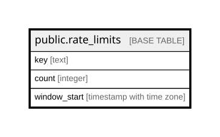

# public.rate_limits

## Description

Fixed-window rate-limit buckets for auth and booking endpoints. Rows older than a day are deleted by the expire-pending-bookings cron.

## Columns

| Name         | Type                     | Default | Nullable | Children | Parents | Comment                                   |
| ------------ | ------------------------ | ------- | -------- | -------- | ------- | ----------------------------------------- |
| key          | text                     |         | false    |          |         | Bucket name, e.g. otp-request:ip:1.2.3.4. |
| count        | integer                  | 1       | false    |          |         | Requests counted in the current window.   |
| window_start | timestamp with time zone | now()   | false    |          |         | Start of the current window.              |

## Constraints

| Name             | Type        | Definition        |
| ---------------- | ----------- | ----------------- |
| rate_limits_pkey | PRIMARY KEY | PRIMARY KEY (key) |

## Indexes

| Name             | Definition                                                                   |
| ---------------- | ---------------------------------------------------------------------------- |
| rate_limits_pkey | CREATE UNIQUE INDEX rate_limits_pkey ON public.rate_limits USING btree (key) |

## Relations

---

> Generated by [tbls](https://github.com/k1LoW/tbls)
