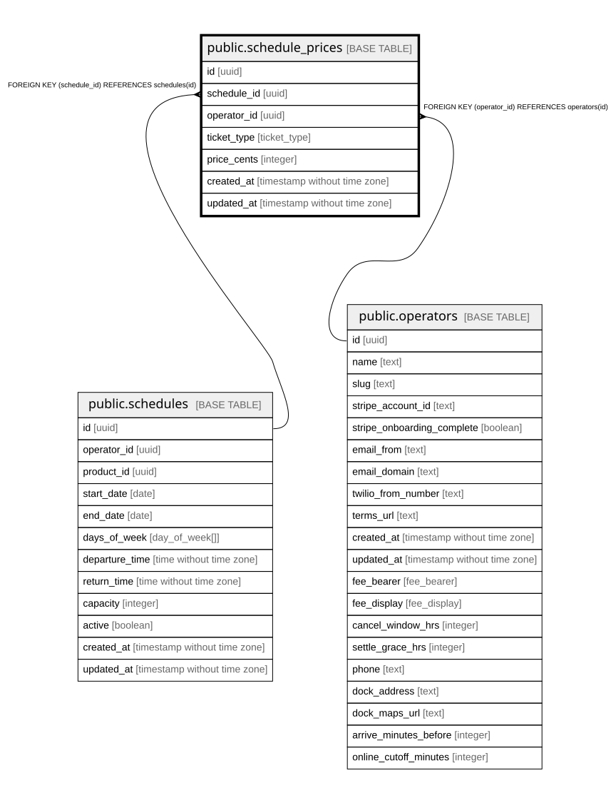

# public.schedule_prices

## Description

Per-schedule price overrides. Take precedence over product_prices at booking time, which enables weekday vs. weekend pricing through separate schedules. Falls back to product_prices when no row exists.

## Columns

| Name        | Type                        | Default           | Nullable | Children | Parents                                 | Comment                                                       |
| ----------- | --------------------------- | ----------------- | -------- | -------- | --------------------------------------- | ------------------------------------------------------------- |
| id          | uuid                        | gen_random_uuid() | false    |          |                                         |                                                               |
| schedule_id | uuid                        |                   | false    |          | [public.schedules](public.schedules.md) |                                                               |
| operator_id | uuid                        |                   | false    |          | [public.operators](public.operators.md) | Owning operator. Every query on this table must filter by it. |
| ticket_type | ticket_type                 |                   | false    |          |                                         |                                                               |
| price_cents | integer                     |                   | false    |          |                                         | Ticket price in cents.                                        |
| created_at  | timestamp without time zone | now()             | false    |          |                                         |                                                               |
| updated_at  | timestamp without time zone | now()             | false    |          |                                         |                                                               |

## Constraints

| Name                                           | Type        | Definition                                         |
| ---------------------------------------------- | ----------- | -------------------------------------------------- |
| schedule_prices_operator_id_operators_id_fk    | FOREIGN KEY | FOREIGN KEY (operator_id) REFERENCES operators(id) |
| schedule_prices_schedule_id_schedules_id_fk    | FOREIGN KEY | FOREIGN KEY (schedule_id) REFERENCES schedules(id) |
| schedule_prices_pkey                           | PRIMARY KEY | PRIMARY KEY (id)                                   |
| schedule_prices_schedule_id_ticket_type_unique | UNIQUE      | UNIQUE (schedule_id, ticket_type)                  |

## Indexes

| Name                                           | Definition                                                                                                                          |
| ---------------------------------------------- | ----------------------------------------------------------------------------------------------------------------------------------- |
| schedule_prices_pkey                           | CREATE UNIQUE INDEX schedule_prices_pkey ON public.schedule_prices USING btree (id)                                                 |
| schedule_prices_schedule_id_ticket_type_unique | CREATE UNIQUE INDEX schedule_prices_schedule_id_ticket_type_unique ON public.schedule_prices USING btree (schedule_id, ticket_type) |
| schedule_prices_schedule_idx                   | CREATE INDEX schedule_prices_schedule_idx ON public.schedule_prices USING btree (schedule_id)                                       |

## Relations

---

> Generated by [tbls](https://github.com/k1LoW/tbls)
