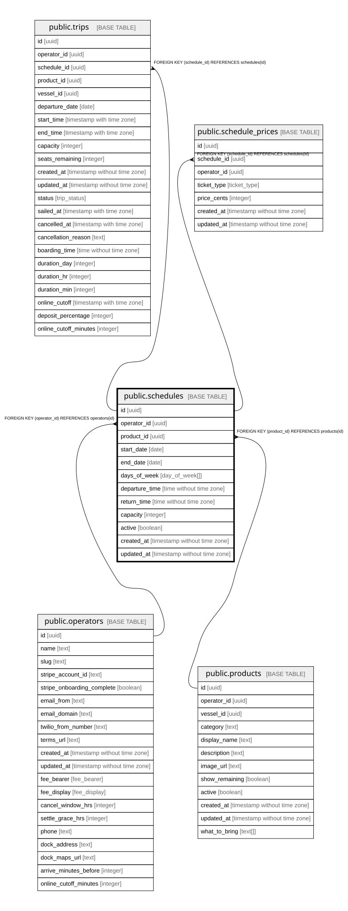

# public.schedules

## Description

Recurring departure pattern for a product. Trips are materialized from it when it is saved.

## Columns

| Name           | Type                        | Default           | Nullable | Children                                                                            | Parents                                 | Comment                                                                        |
| -------------- | --------------------------- | ----------------- | -------- | ----------------------------------------------------------------------------------- | --------------------------------------- | ------------------------------------------------------------------------------ |
| id             | uuid                        | gen_random_uuid() | false    | [public.trips](public.trips.md) [public.schedule_prices](public.schedule_prices.md) |                                         |                                                                                |
| operator_id    | uuid                        |                   | false    |                                                                                     | [public.operators](public.operators.md) | Owning operator. Every query on this table must filter by it.                  |
| product_id     | uuid                        |                   | false    |                                                                                     | [public.products](public.products.md)   |                                                                                |
| start_date     | date                        |                   | false    |                                                                                     |                                         | First date the pattern runs (inclusive).                                       |
| end_date       | date                        |                   | false    |                                                                                     |                                         | Last date the pattern runs (inclusive).                                        |
| days_of_week   | day_of_week[]               |                   | false    |                                                                                     |                                         | Days the trip runs.                                                            |
| departure_time | time without time zone      |                   | false    |                                                                                     |                                         | Local departure time.                                                          |
| return_time    | time without time zone      |                   | false    |                                                                                     |                                         | Local return time. Trips usually last 4 to 5 hours and can end after midnight. |
| capacity       | integer                     |                   | false    |                                                                                     |                                         | Seats per trip. Can differ from the vessel default.                            |
| active         | boolean                     | true              | false    |                                                                                     |                                         |                                                                                |
| created_at     | timestamp without time zone | now()             | false    |                                                                                     |                                         |                                                                                |
| updated_at     | timestamp without time zone | now()             | false    |                                                                                     |                                         |                                                                                |

## Constraints

| Name                                  | Type        | Definition                                         |
| ------------------------------------- | ----------- | -------------------------------------------------- |
| schedules_operator_id_operators_id_fk | FOREIGN KEY | FOREIGN KEY (operator_id) REFERENCES operators(id) |
| schedules_product_id_products_id_fk   | FOREIGN KEY | FOREIGN KEY (product_id) REFERENCES products(id)   |
| schedules_pkey                        | PRIMARY KEY | PRIMARY KEY (id)                                   |

## Indexes

| Name           | Definition                                                              |
| -------------- | ----------------------------------------------------------------------- |
| schedules_pkey | CREATE UNIQUE INDEX schedules_pkey ON public.schedules USING btree (id) |

## Relations

---

> Generated by [tbls](https://github.com/k1LoW/tbls)
