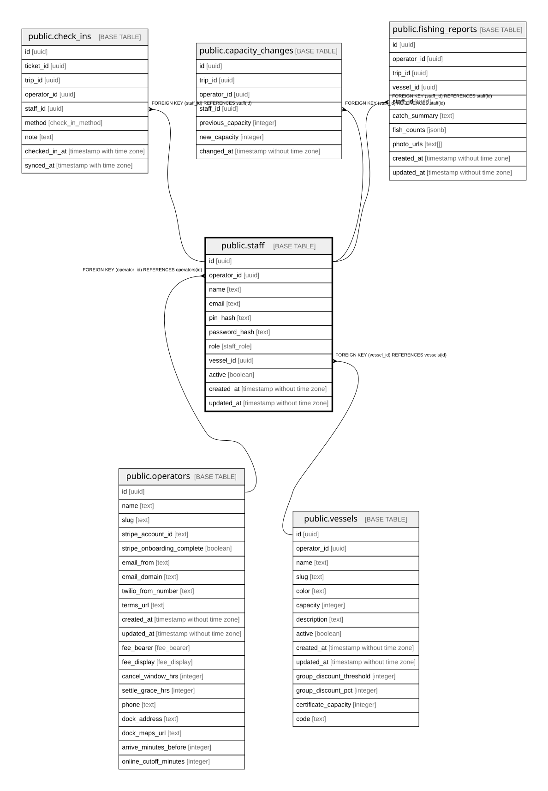

# public.staff

## Description

Admin and mate accounts. Mates sign in to the tablet app with a PIN; admins sign in to the web dashboard with a password.

## Columns

| Name          | Type                        | Default           | Nullable | Children                                                                                                                                          | Parents                                 | Comment                                                       |
| ------------- | --------------------------- | ----------------- | -------- | ------------------------------------------------------------------------------------------------------------------------------------------------- | --------------------------------------- | ------------------------------------------------------------- |
| id            | uuid                        | gen_random_uuid() | false    | [public.check_ins](public.check_ins.md) [public.capacity_changes](public.capacity_changes.md) [public.fishing_reports](public.fishing_reports.md) |                                         |                                                               |
| operator_id   | uuid                        |                   | false    |                                                                                                                                                   | [public.operators](public.operators.md) | Owning operator. Every query on this table must filter by it. |
| name          | text                        |                   | false    |                                                                                                                                                   |                                         |                                                               |
| email         | text                        |                   | false    |                                                                                                                                                   |                                         |                                                               |
| pin_hash      | text                        |                   | true     |                                                                                                                                                   |                                         | bcrypt hash of the mate tablet PIN.                           |
| password_hash | text                        |                   | true     |                                                                                                                                                   |                                         | bcrypt hash of the admin web password.                        |
| role          | staff_role                  |                   | false    |                                                                                                                                                   |                                         | admin (web dashboard) or mate (check-in app).                 |
| vessel_id     | uuid                        |                   | true     |                                                                                                                                                   | [public.vessels](public.vessels.md)     | Boat a mate is assigned to.                                   |
| active        | boolean                     | true              | false    |                                                                                                                                                   |                                         |                                                               |
| created_at    | timestamp without time zone | now()             | false    |                                                                                                                                                   |                                         |                                                               |
| updated_at    | timestamp without time zone | now()             | false    |                                                                                                                                                   |                                         |                                                               |

## Constraints

| Name                              | Type        | Definition                                         |
| --------------------------------- | ----------- | -------------------------------------------------- |
| staff_operator_id_operators_id_fk | FOREIGN KEY | FOREIGN KEY (operator_id) REFERENCES operators(id) |
| staff_pkey                        | PRIMARY KEY | PRIMARY KEY (id)                                   |
| staff_operator_id_email_unique    | UNIQUE      | UNIQUE (operator_id, email)                        |
| staff_vessel_id_vessels_id_fk     | FOREIGN KEY | FOREIGN KEY (vessel_id) REFERENCES vessels(id)     |

## Indexes

| Name                           | Definition                                                                                          |
| ------------------------------ | --------------------------------------------------------------------------------------------------- |
| staff_pkey                     | CREATE UNIQUE INDEX staff_pkey ON public.staff USING btree (id)                                     |
| staff_operator_id_email_unique | CREATE UNIQUE INDEX staff_operator_id_email_unique ON public.staff USING btree (operator_id, email) |

## Relations

---

> Generated by [tbls](https://github.com/k1LoW/tbls)
