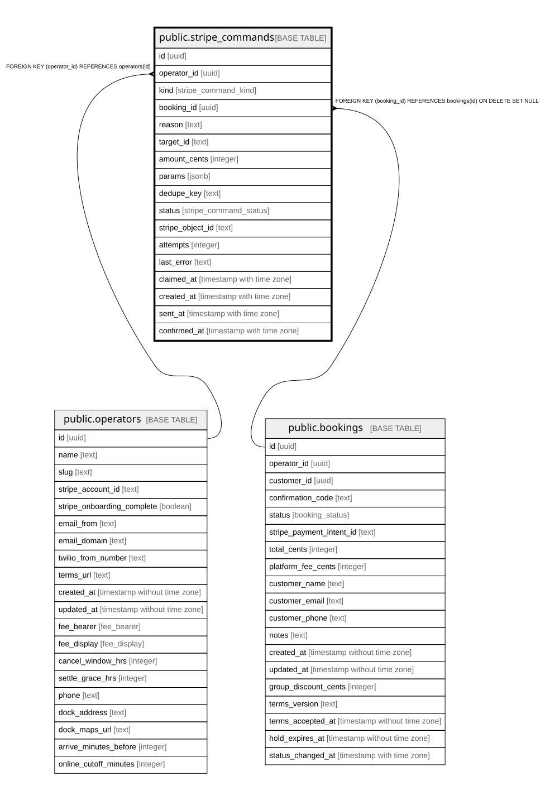

# public.stripe_commands

## Description

Outbox of refunds the app asks Stripe for (row 10). Written in the same transaction as the ticket and seat changes, then sent; the id is the Stripe idempotency key and the refund's metadata.command_id. Pending rows are retried by the expiry cron.

## Columns

| Name             | Type                     | Default                          | Nullable | Children | Parents                                 | Comment                                                                                                                                                                    |
| ---------------- | ------------------------ | -------------------------------- | -------- | -------- | --------------------------------------- | -------------------------------------------------------------------------------------------------------------------------------------------------------------------------- |
| id               | uuid                     |                                  | false    |          |                                         |                                                                                                                                                                            |
| operator_id      | uuid                     |                                  | false    |          | [public.operators](public.operators.md) |                                                                                                                                                                            |
| kind             | stripe_command_kind      |                                  | false    |          |                                         |                                                                                                                                                                            |
| booking_id       | uuid                     |                                  | true     |          | [public.bookings](public.bookings.md)   |                                                                                                                                                                            |
| reason           | text                     |                                  | false    |          |                                         |                                                                                                                                                                            |
| target_id        | text                     |                                  | false    |          |                                         | The PaymentIntent (pi_…) for a refund, or the application fee (fee_…) for a fee refund.                                                                                    |
| amount_cents     | integer                  |                                  | true     |          |                                         | Amount to refund. Null = everything left.                                                                                                                                  |
| params           | jsonb                    |                                  | false    |          |                                         | The exact request sent to Stripe, so every retry sends the same one.                                                                                                       |
| dedupe_key       | text                     |                                  | true     |          |                                         | Unique key for a command that could otherwise be queued twice (an auto-refund, a fee reversal on a Dashboard refund).                                                      |
| status           | stripe_command_status    | 'pending'::stripe_command_status | false    |          |                                         | pending (not yet accepted by Stripe), sent (accepted; a refund is confirmed when charge.refunded arrives), confirmed, failed (refused by Stripe; shown on the Money page). |
| stripe_object_id | text                     |                                  | true     |          |                                         | The Stripe refund (re_…) or fee refund (fr_…) created.                                                                                                                     |
| attempts         | integer                  | 0                                | false    |          |                                         |                                                                                                                                                                            |
| last_error       | text                     |                                  | true     |          |                                         |                                                                                                                                                                            |
| claimed_at       | timestamp with time zone |                                  | true     |          |                                         | Lease taken by the worker sending the command; another may take it over after five minutes.                                                                                |
| created_at       | timestamp with time zone | now()                            | false    |          |                                         |                                                                                                                                                                            |
| sent_at          | timestamp with time zone |                                  | true     |          |                                         |                                                                                                                                                                            |
| confirmed_at     | timestamp with time zone |                                  | true     |          |                                         |                                                                                                                                                                            |
| resolved_at      | timestamp with time zone |                                  | true     |          |                                         | When a person marked a failed command dealt with on the Money page (for example, refunded by hand in Stripe).                                                              |
| resolved_by      | uuid                     |                                  | true     |          | [public.staff](public.staff.md)         | Staff member who marked it dealt with.                                                                                                                                     |
| stripe_account   | text                     |                                  | true     |          |                                         | The connected account a refund is made on (row 32); null = the platform.                                                                                                   |

## Constraints

| Name                                        | Type        | Definition                                                          |
| ------------------------------------------- | ----------- | ------------------------------------------------------------------- |
| stripe_commands_booking_id_bookings_id_fk   | FOREIGN KEY | FOREIGN KEY (booking_id) REFERENCES bookings(id) ON DELETE SET NULL |
| stripe_commands_operator_id_operators_id_fk | FOREIGN KEY | FOREIGN KEY (operator_id) REFERENCES operators(id)                  |
| stripe_commands_resolved_by_staff_id_fk     | FOREIGN KEY | FOREIGN KEY (resolved_by) REFERENCES staff(id) ON DELETE SET NULL   |
| stripe_commands_pkey                        | PRIMARY KEY | PRIMARY KEY (id)                                                    |
| stripe_commands_dedupe_key_unique           | UNIQUE      | UNIQUE (dedupe_key)                                                 |

## Indexes

| Name                                | Definition                                                                                                   |
| ----------------------------------- | ------------------------------------------------------------------------------------------------------------ |
| stripe_commands_pkey                | CREATE UNIQUE INDEX stripe_commands_pkey ON public.stripe_commands USING btree (id)                          |
| stripe_commands_dedupe_key_unique   | CREATE UNIQUE INDEX stripe_commands_dedupe_key_unique ON public.stripe_commands USING btree (dedupe_key)     |
| stripe_commands_status_idx          | CREATE INDEX stripe_commands_status_idx ON public.stripe_commands USING btree (status, created_at)           |
| stripe_commands_operator_status_idx | CREATE INDEX stripe_commands_operator_status_idx ON public.stripe_commands USING btree (operator_id, status) |
| stripe_commands_booking_idx         | CREATE INDEX stripe_commands_booking_idx ON public.stripe_commands USING btree (booking_id)                  |

## Relations

---

> Generated by [tbls](https://github.com/k1LoW/tbls)
