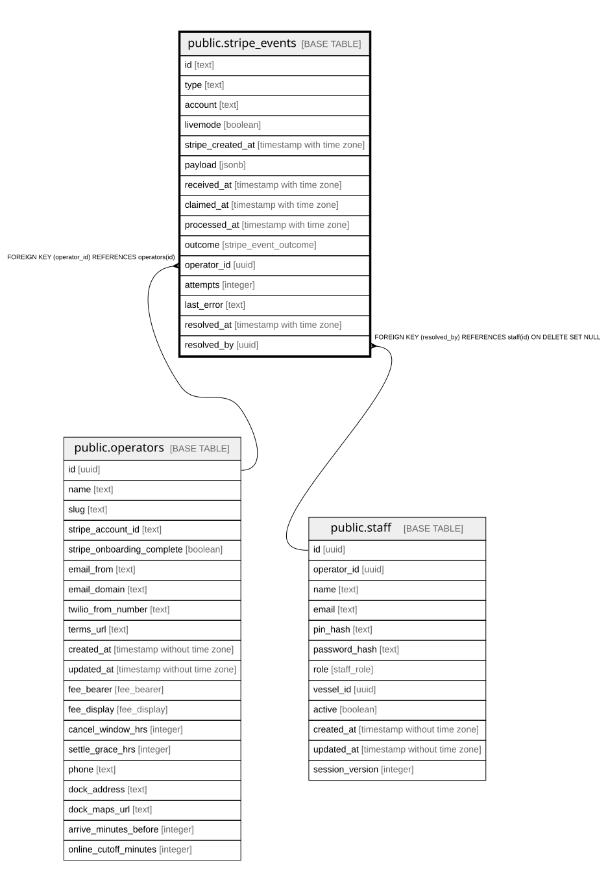

# public.stripe_events

## Description

Inbox of Stripe webhook events, saved before they are acted on (row 10). A redelivery of a saved event is a no-op on the primary key. Unfinished rows (processed_at null) are retried by Stripe redeliveries and the expiry cron.

## Columns

| Name              | Type                     | Default | Nullable | Children | Parents                                 | Comment                                                                                                       |
| ----------------- | ------------------------ | ------- | -------- | -------- | --------------------------------------- | ------------------------------------------------------------------------------------------------------------- |
| id                | text                     |         | false    |          |                                         |                                                                                                               |
| type              | text                     |         | false    |          |                                         |                                                                                                               |
| account           | text                     |         | true     |          |                                         | Set only on events from a connected account; those are always ignored.                                        |
| livemode          | boolean                  |         | false    |          |                                         |                                                                                                               |
| stripe_created_at | timestamp with time zone |         | false    |          |                                         | When Stripe created the event. Drain order, and the clock for giving up after three days.                     |
| payload           | jsonb                    |         | false    |          |                                         |                                                                                                               |
| received_at       | timestamp with time zone | now()   | false    |          |                                         |                                                                                                               |
| claimed_at        | timestamp with time zone |         | true     |          |                                         | Lease taken by the worker processing the event; another worker may take it over after five minutes.           |
| processed_at      | timestamp with time zone |         | true     |          |                                         | When processing finished. Null = still to do.                                                                 |
| outcome           | stripe_event_outcome     |         | true     |          |                                         | handled, ignored (not this deployment's payment, or nothing to do) or needs_review (shown on the Money page). |
| operator_id       | uuid                     |         | true     |          | [public.operators](public.operators.md) | Operator the event belongs to, once a handler resolved it. Null for events that aren't ours.                  |
| attempts          | integer                  | 0       | false    |          |                                         |                                                                                                               |
| last_error        | text                     |         | true     |          |                                         | Last failure while unfinished; once finished, why it was ignored or needs review.                             |
| resolved_at       | timestamp with time zone |         | true     |          |                                         | When a person marked a needs_review event dealt with on the Money page.                                       |
| resolved_by       | uuid                     |         | true     |          | [public.staff](public.staff.md)         | Staff member who marked it dealt with.                                                                        |

## Constraints

| Name                                      | Type        | Definition                                                        |
| ----------------------------------------- | ----------- | ----------------------------------------------------------------- |
| stripe_events_operator_id_operators_id_fk | FOREIGN KEY | FOREIGN KEY (operator_id) REFERENCES operators(id)                |
| stripe_events_resolved_by_staff_id_fk     | FOREIGN KEY | FOREIGN KEY (resolved_by) REFERENCES staff(id) ON DELETE SET NULL |
| stripe_events_pkey                        | PRIMARY KEY | PRIMARY KEY (id)                                                  |

## Indexes

| Name                               | Definition                                                                                                                      |
| ---------------------------------- | ------------------------------------------------------------------------------------------------------------------------------- |
| stripe_events_pkey                 | CREATE UNIQUE INDEX stripe_events_pkey ON public.stripe_events USING btree (id)                                                 |
| stripe_events_unprocessed_idx      | CREATE INDEX stripe_events_unprocessed_idx ON public.stripe_events USING btree (stripe_created_at) WHERE (processed_at IS NULL) |
| stripe_events_operator_outcome_idx | CREATE INDEX stripe_events_operator_outcome_idx ON public.stripe_events USING btree (operator_id, outcome)                      |

## Relations

---

> Generated by [tbls](https://github.com/k1LoW/tbls)
