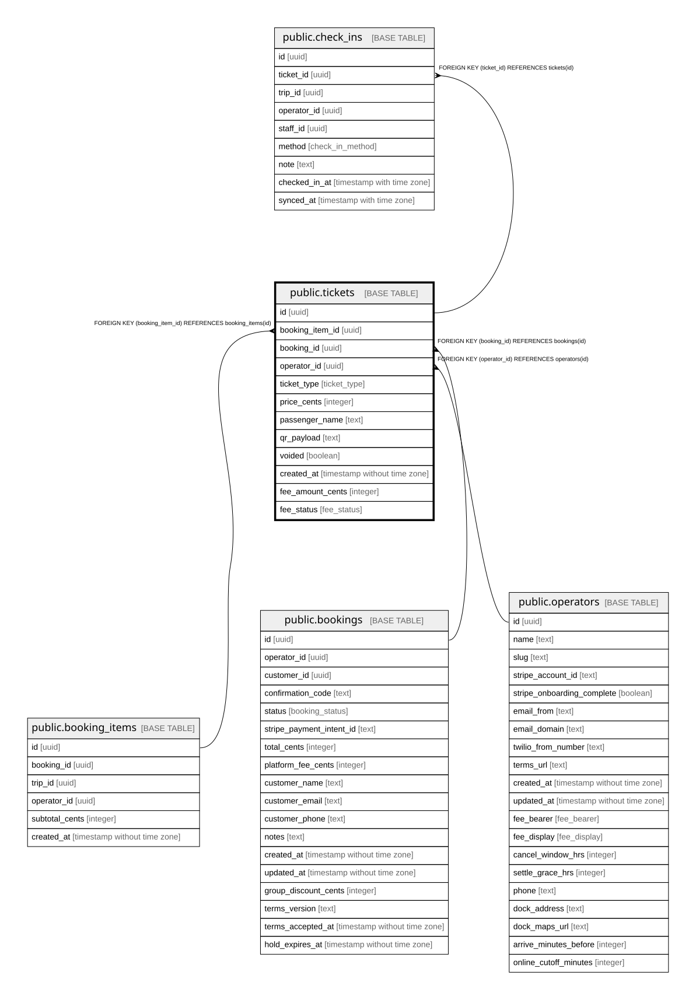

# public.tickets

## Description

One per passenger, on one trip via its booking_item.

## Columns

| Name             | Type                        | Default            | Nullable | Children                                | Parents                                         | Comment                                                                                                                |
| ---------------- | --------------------------- | ------------------ | -------- | --------------------------------------- | ----------------------------------------------- | ---------------------------------------------------------------------------------------------------------------------- |
| id               | uuid                        | gen_random_uuid()  | false    | [public.check_ins](public.check_ins.md) |                                                 |                                                                                                                        |
| booking_item_id  | uuid                        |                    | false    |                                         | [public.booking_items](public.booking_items.md) |                                                                                                                        |
| booking_id       | uuid                        |                    | false    |                                         | [public.bookings](public.bookings.md)           |                                                                                                                        |
| operator_id      | uuid                        |                    | false    |                                         | [public.operators](public.operators.md)         | Owning operator. Every query on this table must filter by it.                                                          |
| ticket_type      | ticket_type                 |                    | false    |                                         |                                                 |                                                                                                                        |
| price_cents      | integer                     |                    | false    |                                         |                                                 | Ticket price charged, in cents.                                                                                        |
| passenger_name   | text                        |                    | true     |                                         |                                                 | Name on the boarding pass.                                                                                             |
| qr_payload       | text                        |                    | false    |                                         |                                                 | Value encoded in the boarding-pass QR code and matched when a mate scans it.                                           |
| voided           | boolean                     | false              | false    |                                         |                                                 | True after refund, cancellation or dispute. A voided ticket cannot board.                                              |
| created_at       | timestamp without time zone | now()              | false    |                                         |                                                 |                                                                                                                        |
| fee_amount_cents | integer                     | 150                | false    |                                         |                                                 | Platform fee for this ticket, snapshotted when written. Never re-read from config.                                     |
| fee_status       | fee_status                  | 'held'::fee_status | false    |                                         |                                                 | held at charge -\> earned after departure + settle_grace_hrs, or reversed on cancellation. Revenue counts only earned. |

## Constraints

| Name                                        | Type        | Definition                                                 |
| ------------------------------------------- | ----------- | ---------------------------------------------------------- |
| tickets_booking_item_id_booking_items_id_fk | FOREIGN KEY | FOREIGN KEY (booking_item_id) REFERENCES booking_items(id) |
| tickets_booking_id_bookings_id_fk           | FOREIGN KEY | FOREIGN KEY (booking_id) REFERENCES bookings(id)           |
| tickets_operator_id_operators_id_fk         | FOREIGN KEY | FOREIGN KEY (operator_id) REFERENCES operators(id)         |
| tickets_pkey                                | PRIMARY KEY | PRIMARY KEY (id)                                           |

## Indexes

| Name         | Definition                                                          |
| ------------ | ------------------------------------------------------------------- |
| tickets_pkey | CREATE UNIQUE INDEX tickets_pkey ON public.tickets USING btree (id) |

## Relations

---

> Generated by [tbls](https://github.com/k1LoW/tbls)
