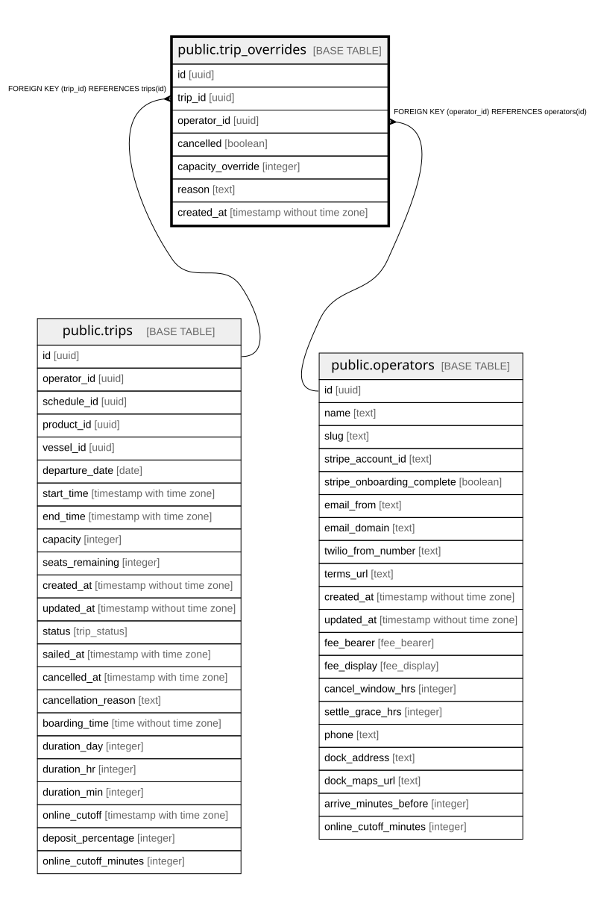

# public.trip_overrides

## Description

Admin-applied exceptions for a specific trip: cancellations or capacity changes.

## Columns

| Name              | Type                        | Default           | Nullable | Children | Parents                                 | Comment                                                       |
| ----------------- | --------------------------- | ----------------- | -------- | -------- | --------------------------------------- | ------------------------------------------------------------- |
| id                | uuid                        | gen_random_uuid() | false    |          |                                         |                                                               |
| trip_id           | uuid                        |                   | false    |          | [public.trips](public.trips.md)         |                                                               |
| operator_id       | uuid                        |                   | false    |          | [public.operators](public.operators.md) | Owning operator. Every query on this table must filter by it. |
| cancelled         | boolean                     |                   | true     |          |                                         |                                                               |
| capacity_override | integer                     |                   | true     |          |                                         | Replacement capacity for this trip.                           |
| reason            | text                        |                   | true     |          |                                         | Why the override was applied.                                 |
| created_at        | timestamp without time zone | now()             | false    |          |                                         |                                                               |

## Constraints

| Name                                       | Type        | Definition                                         |
| ------------------------------------------ | ----------- | -------------------------------------------------- |
| trip_overrides_operator_id_operators_id_fk | FOREIGN KEY | FOREIGN KEY (operator_id) REFERENCES operators(id) |
| trip_overrides_pkey                        | PRIMARY KEY | PRIMARY KEY (id)                                   |
| trip_overrides_trip_id_trips_id_fk         | FOREIGN KEY | FOREIGN KEY (trip_id) REFERENCES trips(id)         |

## Indexes

| Name                | Definition                                                                        |
| ------------------- | --------------------------------------------------------------------------------- |
| trip_overrides_pkey | CREATE UNIQUE INDEX trip_overrides_pkey ON public.trip_overrides USING btree (id) |

## Relations

---

> Generated by [tbls](https://github.com/k1LoW/tbls)
