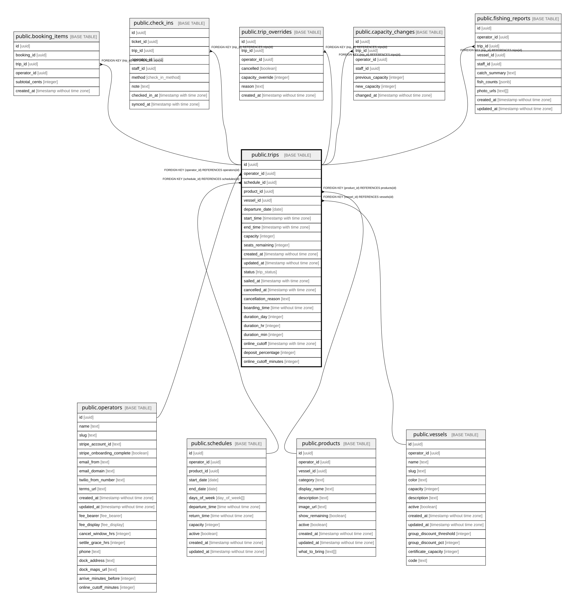

# public.trips

## Description

One materialized departure. Written when a schedule is saved, or added by hand as a one-off. (schedule_id, departure_date) is unique.

## Columns

| Name                  | Type                        | Default                  | Nullable | Children                                                                                                                                                                                                                                            | Parents                                 | Comment                                                                                                                                 |
| --------------------- | --------------------------- | ------------------------ | -------- | --------------------------------------------------------------------------------------------------------------------------------------------------------------------------------------------------------------------------------------------------- | --------------------------------------- | --------------------------------------------------------------------------------------------------------------------------------------- |
| id                    | uuid                        | gen_random_uuid()        | false    | [public.booking_items](public.booking_items.md) [public.check_ins](public.check_ins.md) [public.trip_overrides](public.trip_overrides.md) [public.capacity_changes](public.capacity_changes.md) [public.fishing_reports](public.fishing_reports.md) |                                         |                                                                                                                                         |
| operator_id           | uuid                        |                          | false    |                                                                                                                                                                                                                                                     | [public.operators](public.operators.md) | Owning operator. Every query on this table must filter by it.                                                                           |
| schedule_id           | uuid                        |                          | true     |                                                                                                                                                                                                                                                     | [public.schedules](public.schedules.md) | Schedule that generated this trip. Null = one-off departure added by hand.                                                              |
| product_id            | uuid                        |                          | false    |                                                                                                                                                                                                                                                     | [public.products](public.products.md)   |                                                                                                                                         |
| vessel_id             | uuid                        |                          | false    |                                                                                                                                                                                                                                                     | [public.vessels](public.vessels.md)     |                                                                                                                                         |
| departure_date        | date                        |                          | false    |                                                                                                                                                                                                                                                     |                                         | Local calendar date of departure.                                                                                                       |
| start_time            | timestamp with time zone    |                          | false    |                                                                                                                                                                                                                                                     |                                         | Departure instant.                                                                                                                      |
| end_time              | timestamp with time zone    |                          | false    |                                                                                                                                                                                                                                                     |                                         | Return instant. Can fall on the next calendar day.                                                                                      |
| capacity              | integer                     |                          | false    |                                                                                                                                                                                                                                                     |                                         | Total seats on this trip.                                                                                                               |
| seats_remaining       | integer                     |                          | false    |                                                                                                                                                                                                                                                     |                                         | Unsold seats. Change only with SQL arithmetic inside a FOR UPDATE transaction, never read-check-write.                                  |
| created_at            | timestamp without time zone | now()                    | false    |                                                                                                                                                                                                                                                     |                                         |                                                                                                                                         |
| updated_at            | timestamp without time zone | now()                    | false    |                                                                                                                                                                                                                                                     |                                         |                                                                                                                                         |
| status                | trip_status                 | 'scheduled'::trip_status | false    |                                                                                                                                                                                                                                                     |                                         | scheduled (bookable) -\> pending_settlement (departed, inside the grace window) -\> sailed (fees earned), or cancelled (fees reversed). |
| sailed_at             | timestamp with time zone    |                          | true     |                                                                                                                                                                                                                                                     |                                         | When the trip moved to sailed.                                                                                                          |
| cancelled_at          | timestamp with time zone    |                          | true     |                                                                                                                                                                                                                                                     |                                         | When the trip was cancelled.                                                                                                            |
| cancellation_reason   | text                        |                          | true     |                                                                                                                                                                                                                                                     |                                         | weather, mechanical, low_bookings, or free text.                                                                                        |
| boarding_time         | time without time zone      |                          | true     |                                                                                                                                                                                                                                                     |                                         | Boarding time when it differs from departure, e.g. board 06:30, depart 07:00.                                                           |
| duration_day          | integer                     | 0                        | false    |                                                                                                                                                                                                                                                     |                                         | Whole days of a multi-day trip. 0 for same-day trips.                                                                                   |
| duration_hr           | integer                     |                          | true     |                                                                                                                                                                                                                                                     |                                         | Hours part of the trip duration.                                                                                                        |
| duration_min          | integer                     |                          | true     |                                                                                                                                                                                                                                                     |                                         | Minutes part of the trip duration.                                                                                                      |
| online_cutoff         | timestamp with time zone    |                          | true     |                                                                                                                                                                                                                                                     |                                         | Deprecated, never read or written. Superseded by online_cutoff_minutes.                                                                 |
| deposit_percentage    | integer                     |                          | true     |                                                                                                                                                                                                                                                     |                                         | Percent charged up front. Null = pay in full.                                                                                           |
| online_cutoff_minutes | integer                     |                          | true     |                                                                                                                                                                                                                                                     |                                         | Per-trip override of operators.online_cutoff_minutes. Null = operator default.                                                          |

## Constraints

| Name                                    | Type        | Definition                                         |
| --------------------------------------- | ----------- | -------------------------------------------------- |
| trips_online_cutoff_minutes_check       | CHECK       | CHECK ((online_cutoff_minutes >= 0))               |
| trips_seats_remaining_non_negative      | CHECK       | CHECK ((seats_remaining >= 0))                     |
| trips_operator_id_operators_id_fk       | FOREIGN KEY | FOREIGN KEY (operator_id) REFERENCES operators(id) |
| trips_product_id_products_id_fk         | FOREIGN KEY | FOREIGN KEY (product_id) REFERENCES products(id)   |
| trips_schedule_id_schedules_id_fk       | FOREIGN KEY | FOREIGN KEY (schedule_id) REFERENCES schedules(id) |
| trips_pkey                              | PRIMARY KEY | PRIMARY KEY (id)                                   |
| trips_schedule_id_departure_date_unique | UNIQUE      | UNIQUE (schedule_id, departure_date)               |
| trips_vessel_id_vessels_id_fk           | FOREIGN KEY | FOREIGN KEY (vessel_id) REFERENCES vessels(id)     |

## Indexes

| Name                                    | Definition                                                                                                            |
| --------------------------------------- | --------------------------------------------------------------------------------------------------------------------- |
| trips_pkey                              | CREATE UNIQUE INDEX trips_pkey ON public.trips USING btree (id)                                                       |
| trips_schedule_id_departure_date_unique | CREATE UNIQUE INDEX trips_schedule_id_departure_date_unique ON public.trips USING btree (schedule_id, departure_date) |
| trips_operator_date_idx                 | CREATE INDEX trips_operator_date_idx ON public.trips USING btree (operator_id, departure_date)                        |

## Relations

---

> Generated by [tbls](https://github.com/k1LoW/tbls)
