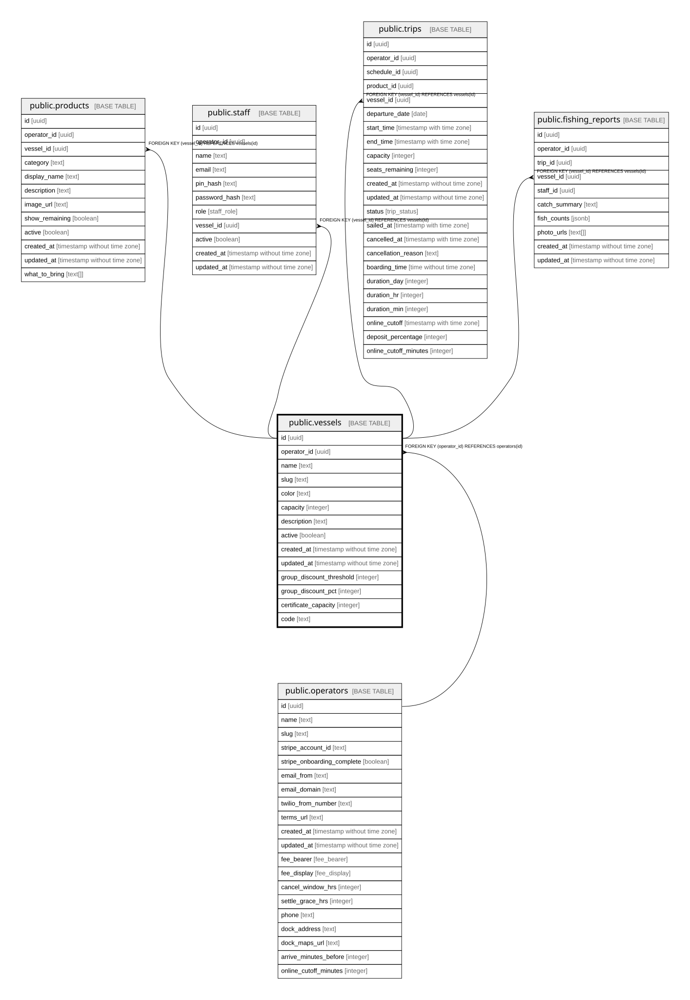

# public.vessels

## Description

Boats owned by an operator.

## Columns

| Name                     | Type                        | Default           | Nullable | Children                                                                                                                                                  | Parents                                 | Comment                                                                                      |
| ------------------------ | --------------------------- | ----------------- | -------- | --------------------------------------------------------------------------------------------------------------------------------------------------------- | --------------------------------------- | -------------------------------------------------------------------------------------------- |
| id                       | uuid                        | gen_random_uuid() | false    | [public.products](public.products.md) [public.staff](public.staff.md) [public.trips](public.trips.md) [public.fishing_reports](public.fishing_reports.md) |                                         |                                                                                              |
| operator_id              | uuid                        |                   | false    |                                                                                                                                                           | [public.operators](public.operators.md) | Owning operator. Every query on this table must filter by it.                                |
| name                     | text                        |                   | false    |                                                                                                                                                           |                                         |                                                                                              |
| slug                     | text                        |                   | false    |                                                                                                                                                           |                                         |                                                                                              |
| color                    | text                        |                   | false    |                                                                                                                                                           |                                         | Hex colour used to tell vessels apart in the UI, e.g. #1D4ED8.                               |
| capacity                 | integer                     |                   | false    |                                                                                                                                                           |                                         | Passenger capacity.                                                                          |
| description              | text                        |                   | true     |                                                                                                                                                           |                                         |                                                                                              |
| active                   | boolean                     | true              | false    |                                                                                                                                                           |                                         | False = vessel retired. Inactive vessels are left out of admin pickers.                      |
| created_at               | timestamp without time zone | now()             | false    |                                                                                                                                                           |                                         |                                                                                              |
| updated_at               | timestamp without time zone | now()             | false    |                                                                                                                                                           |                                         |                                                                                              |
| group_discount_threshold | integer                     |                   | true     |                                                                                                                                                           |                                         | Tickets on this vessel in one booking needed to trigger the group discount. Null = disabled. |
| group_discount_pct       | integer                     |                   | true     |                                                                                                                                                           |                                         | Percent taken off qualifying tickets when the group discount applies.                        |
| certificate_capacity     | integer                     |                   | true     |                                                                                                                                                           |                                         | Legal maximum passengers from the vessel's certificate. Null = not configured.               |
| code                     | text                        |                   | true     |                                                                                                                                                           |                                         | Short display code, e.g. LLX.                                                                |

## Constraints

| Name                                | Type        | Definition                                         |
| ----------------------------------- | ----------- | -------------------------------------------------- |
| vessels_operator_id_operators_id_fk | FOREIGN KEY | FOREIGN KEY (operator_id) REFERENCES operators(id) |
| vessels_pkey                        | PRIMARY KEY | PRIMARY KEY (id)                                   |
| vessels_operator_id_slug_unique     | UNIQUE      | UNIQUE (operator_id, slug)                         |

## Indexes

| Name                            | Definition                                                                                            |
| ------------------------------- | ----------------------------------------------------------------------------------------------------- |
| vessels_pkey                    | CREATE UNIQUE INDEX vessels_pkey ON public.vessels USING btree (id)                                   |
| vessels_operator_id_slug_unique | CREATE UNIQUE INDEX vessels_operator_id_slug_unique ON public.vessels USING btree (operator_id, slug) |

## Relations

---

> Generated by [tbls](https://github.com/k1LoW/tbls)
